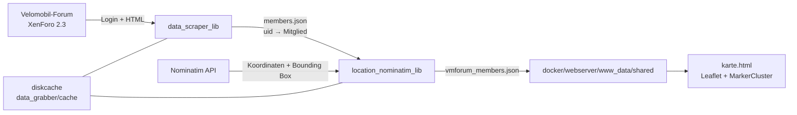

# vmkarte – Codeanalyse und Dokumentation

**Stand:** 23.10.2026
**Gegenstand:** Analyse des bestehenden Codes, Dokumentation der Architektur und Eingrenzung der aktuellen Fehlerursachen.

---

## 1. Kurzfassung

Die Vermutung, dass der „Screen-Grabber“ wegen einer Änderung der Forum-Software nicht mehr funktioniert, konnte **nicht bestätigt** werden.

Live-Prüfung am 22.10.2026:

- Das Forum läuft mit **XenForo 2.3** (`data-xf="2.3"` im HTML).
- Der Login über `index.php?login/login` mit `_xfToken` funktioniert weiterhin.
- Die Mitgliederliste ist nach dem Login abrufbar (HTTP 200).
- Die verwendeten Selektoren existieren weiterhin:
  - `h3.contentRow-header a.username` → 20 Treffer auf Seite 1
  - `div.contentRow-main` / `div.contentRow-lesser` → 20 Treffer
  - `dl.pairs--columns` auf der „Über“-Seite → vorhanden
- Die Paginierung liefert weiterhin Seitenzahlen; aktuell maximal **345 Seiten** (ca. 6.900 Mitglieder).

**Die Hauptursache war eine andere:** Die Nominatim-Abfragen wurden von OpenStreetMap mit **HTTP 403 „Access denied“** abgewiesen, weil beim Request **kein User-Agent** mitgesendet wurde. Das war im Code eindeutig nachvollziehbar und wurde live reproduziert.

Am 22.10.2026 wurde der Arbeitsstand auf den Masterstand (`3c9e3fc`) zurückgesetzt. Die zuvor vorhandenen Debug-Änderungen (Scraper auskommentiert, abweichende Ausgabepfade) sind damit **nicht mehr aktiv**. Sie sind in Befund C und D nur noch als historische Notiz dokumentiert.

Zusätzlich wurden fehlgeschlagene Nominatim-Abfragen als `None` mit einer TTL von 365 Tagen gecacht. Durch das damalige tägliche 1-%-Thinning war die effektive Lebensdauer kürzer, lag aber weiterhin bei Wochen bis Monaten.

**Umgesetzt am 22.10.2026:**

- Nominatim-Requests senden jetzt einen konfigurierbaren, identifizierenden User-Agent und verwenden einen Timeout.
- Nur erfolgreiche Nominatim-Ergebnisse werden gecacht; Fehler und negative Treffer nicht mehr.
- Ein Hilfsskript zum Leeren des `nominatim`-Caches wurde ergänzt und auf die vorhandenen lokalen Caches angewendet.

**Umgesetzt am 23.10.2026:**

- Die TTL-Bereiche für `user_details` und `nominatim` stehen in der eingecheckten `cache_config.json` und werden pro Eintrag zufällig gezogen.
- Das 1-%-Thinning entfällt; `--fast` wird nur noch aus Kompatibilitätsgründen akzeptiert.
- Jedes Mitglied erhält `profile_updated_at`; die Karte zeigt den Stand im Popup als Datum.

---

## 2. Projektzweck

Das Projekt liest Mitgliederdaten aus dem Velomobil-Forum, ermittelt aus der freiwillig angegebenen Ortsangabe Koordinaten über Nominatim/OpenStreetMap und erzeugt daraus eine JSON-Datei. Diese wird von einer statischen Leaflet-Karte im Browser angezeigt.

Es handelt sich nicht um einen Screenshot- oder OCR-basierten „Screen-Grabber“, sondern um einen **HTML-Scraper** mit `requests` und `BeautifulSoup`.

---

## 3. Repository-Struktur

```text
vmkarte/
├── src/data_grabber/
│   ├── data_grabber.py                 # Einstiegspunkt / Orchestrierung
│   ├── config.example.json             # Vorlage für lokale Zugangsdaten
│   ├── cache_config.json               # Konfiguration der Cache-TTLs
│   ├── libs/
│   │   ├── data_scraper_lib.py         # Forum-Login und HTML-Parsing
│   │   ├── location_nominatim_lib.py   # Nominatim-Abfragen und Radius
│   │   ├── location_mapping_rules_lib.py # Orts-/Länder-/PLZ-Normalisierung
│   │   ├── cache_config_lib.py         # Laden/Validieren der Cache-TTLs
│   │   ├── paths_lib.py                # Einheitliche Laufzeitpfade
│   │   ├── country_mapping.json        # Ländernamen/-kürzel → Ländercode
│   │   └── kuerzel_mapping.json        # Deutsche Kfz-/Ortskürzel → Ortsname
│   └── utils/
│       ├── cache.py                    # Interaktives Cache-Verwaltungsskript
│       └── delete_user_cash_entry.py   # Löscht einen user_details-Cacheeintrag
├── docker/
│   ├── cron/                           # Cron-Container für den Datengrabber
│   └── webserver/                      # nginx + statische Karte
├── docker/webserver/www_data/
│   ├── karte.html                      # Leaflet-Frontend
│   ├── geo-handler.php                 # geo:-Weiterleitung zu BRouter
│   ├── leaflet/                        # Leaflet-Bibliothek
│   ├── markercluster/                  # Marker-Cluster-Plugin
│   └── shared/                         # Kartendaten (Laufzeit, ignoriert)
├── docs/
│   ├── upgrade-docker.md               # Upgrade-Anleitung Docker
│   └── upgrade-native.md               # Upgrade-Anleitung native Installation
├── config/                             # Laufzeitkonfiguration (ignoriert)
├── volumes/                            # Docker-Cache (ignoriert)
├── requirements.txt
├── setup.py
└── docker-compose.yml.sample
```

---

## 4. Architektur und Datenfluss



### Ablauf eines vollständigen Laufs

1. `data_grabber.py` parst die CLI-Parameter; `--fast` wird aus Kompatibilitätsgründen noch akzeptiert, hat aber keine Wirkung mehr.
2. `cache_config_lib.py` lädt die TTL-Bereiche für `user_details` und `nominatim` aus `cache_config.json`.
3. `get_member_data()` loggt sich ins Forum ein, lädt alle Mitgliederseiten und ruft für jedes Mitglied die „Über“-Seite auf.
4. Die Mitgliederdaten werden als `members.json` zwischengespeichert.
5. `examine_locations()` normalisiert die Ortsangabe, ermittelt Land und PLZ, fragt Nominatim ab und berechnet einen Radius aus der Bounding Box.
6. Es werden nur Mitglieder mit erfolgreich aufgelöstem Ort übernommen.
7. Die aufbereiteten Datensätze werden als `vmforum_members.json` geschrieben.
8. Die Karte lädt `shared/vmforum_members.json` per `fetch()`.

---

## 5. Komponenten im Detail

### 5.1 `src/data_grabber/data_grabber.py`

Einstiegspunkt und Orchestrierung.

- CLI-Parameter `--fast`: wird aus Kompatibilitätsgründen noch akzeptiert, hat aber keine Wirkung mehr.
- `get_member_data()` ist aktiv.
- Die Mitgliederdaten werden zur Laufzeit nach `src/data_grabber/members.json` geschrieben (Docker: `/app/members.json`). Diese Datei liegt außerhalb des Web-Roots.
- Die Kartenausgabe erfolgt nach `docker/webserver/www_data/shared/vmforum_members.json` (Docker: `/app/shared/vmforum_members.json`).
- Baut aus jedem Mitglied ein reduziertes Objekt mit `id`, `name`, `lat`, `lon`, `radius` und optional `profile_updated_at`, `vm`, `lr`, `tr`, `other`.
- Das frühere Cache-Thinning entfällt; die Verteilung übernimmt die zufällige TTL aus `cache_config.json`.

### 5.2 `src/data_grabber/libs/data_scraper_lib.py`

Verantwortlich für Login und HTML-Parsing.

**Login**

- Ruft `https://www.velomobilforum.de/forum/index.php?login/login` auf.
- Liest das versteckte Feld `_xfToken`.
- Sendet `login`, `password`, `remember`, `_xfRedirect` und `_xfToken` per POST.
- Prüft den Erfolg über `if 'Log in' in response.text` (`data_scraper_lib.py:57`).

**Mitgliederliste**

- Ermittelt die Seitenzahl über `ul.pageNav-main li.pageNav-page a`.
- Lädt jede Seite über `...?members/list/&page={i}`.
- Parst pro Mitglied:
  - `h3.contentRow-header a.username` → `uid`, `name`, `href`
  - `div.contentRow-main` → Kontext
  - `div.contentRow-lesser a` → optionale Ortsangabe
- Ergebnis wird als Dictionary `uid → Mitglied` aufgebaut.

**Profilseite**

- Ruft `https://www.velomobilforum.de{member['href']}about` auf.
- Sucht `dl.pairs--columns`.
- Liest `dt`/`dd` und mappt:
  - `Velomobil` → `vm`
  - `Liegerad` → `lr`
  - `Trike` → `tr`
  - `sonstige Fahrzeuge/Bemerkungen` → `other`

**Caching**

| Cache-Name | Schlüssel | Laufzeit | Inhalt |
|---|---|---|---|
| `members_dict` | `('members_dict',)` | 23 h | komplettes Mitglieder-Dictionary |
| `user_details` | `('user_details', uid)` | 7–14 Tage (konfigurierbar) | angereichertes Mitgliedsobjekt inkl. `profile_updated_at` |
| `nominatim` | `('nominatim', searchstring, country_code)` | 180–365 Tage (konfigurierbar) | nur erfolgreiche Nominatim-Antworten |

Die TTL wird für jeden neuen Cacheeintrag zufällig aus dem in `cache_config.json` konfigurierten Bereich gezogen. Dadurch verteilen sich die Profil- und Geocoding-Aktualisierungen über die Zeit. Sind `ttl_days_min` und `ttl_days_max` gleich, ist die TTL fest.

**Wichtig zur Wirkung:** Der `members_dict`-Cache ist als **Entwicklungshilfe** gedacht. Bei mehreren Läufen innerhalb von 23 Stunden spart er die 345 Mitgliederseiten. Im täglichen Produktivbetrieb (Cron alle 24 h) ist die TTL dagegen vor jedem Lauf abgelaufen, sodass die Mitgliederliste ohnehin neu geladen wird. Das ist kein Fehler, sondern der bewusste Kompromiss zugunsten täglicher Aktualität.

`user_details` und `nominatim` entlasten im Produktivbetrieb spürbar Forum und Nominatim. Das frühere 1-%-Thinning ist entfallen, weil die zufällige TTL die Verteilung zuverlässiger übernimmt und keinen 14-Tage-Burst erzeugt.

### 5.3 `src/data_grabber/libs/location_nominatim_lib.py`

**`query_nominatim(searchstring, country_code)`**

- Entfernt führende/abschließende Kommas und Leerzeichen.
- Entfernt bei vorhandenem Ländercode ein Präfix wie `d-90469`.
- Baut die URL:
  `https://nominatim.openstreetmap.org/search?q=...&format=json&addressdetails=1&email=...&countrycodes=...`
- Sendet den Request mit `NOMINATIM_HEADERS` (konfigurierbarer User-Agent) und `NOMINATIM_TIMEOUT` (`location_nominatim_lib.py:46`).
- Bei genau einem Treffer wird ein zweiter Request mit `exclude_place_ids` ausgeführt (`location_nominatim_lib.py:105`), ebenfalls mit Header und Timeout.
- Bevorzugt bestimmte OSM-Typen (PLZ, administrative Grenzen, Stadt, Dorf usw.).
- Gibt `None` zurück, wenn kein Treffer oder ein Request-Fehler auftritt.
- Cacht **nur erfolgreiche Treffer**; `None` und Fehler werden nicht gespeichert.
- Die TTL für neue Treffer stammt aus `cache_config.json` (Default 180–365 Tage, zufällig pro Eintrag).

**`calculate_radius(boundingbox)`**

- Berechnet die geodätische Distanz von der Bounding-Box-Mitte zur Nordwest-Ecke.
- Gibt einen gerundeten Radius in Metern oder `'N/A'` zurück.

**`examine_locations(members)`**

- Iteriert über das Dictionary `uid → Mitglied`.
- Normalisiert den Ort, ermittelt Land/PLZ.
- Probiert bei unbekanntem Land verschiedene Ländercode-Kombinationen.
- Übernimmt `lat`, `lon`, `radius` nur bei erfolgreicher Nominatim-Antwort.
- Mitglieder ohne Ortsangabe oder ohne Nominatim-Treffer werden nicht in die Ausgabe übernommen.

### 5.4 `src/data_grabber/libs/location_mapping_rules_lib.py`

- Lädt `country_mapping.json` und `kuerzel_mapping.json`.
- `prepare_location()` bereinigt Ortsangaben:
  - Kleinschreibung, Whitespace-Normalisierung
  - Entfernen von Füllwörtern wie „bei“, „nähe“, „von“, „in“
  - Ersetzen zahlreicher Sonderfälle (z. B. „black forest“ → „schwarzwald“)
  - Auflösen deutscher Kürzel (z. B. `A` → `Augsburg`)
- `analyze_location_for_country()` erkennt Ländernamen und Kürzel.
- `analyze_location_for_postal_code()` sucht 4- bis 5-stellige Zahlen.

### 5.5 Cache-Verwaltung und Cache-Konfiguration

- `cache_config_lib.load_cache_config()` liest `cache_config.json` relativ zum `data_grabber`-Verzeichnis.
- Fehlende Datei oder fehlende Werte führen zu den Defaults; ungültige Werte lösen eine klare `ValueError`-Meldung aus.
- `get_ttl_seconds(cache_name)` zieht bei jedem Cache-Schreibvorgang eine zufällige TTL aus dem konfigurierten Bereich.
- Das frühere `cache_thinning_lib.delete_random_cache_data()` und der 1-%-Thinning-Aufruf sind entfallen. Die Verteilung erfolgt über die zufällige TTL.
- `--fast` wird zwar noch akzeptiert, hat aber keine Wirkung mehr.
- `utils/cache.py` ist ein interaktives Werkzeug mit Nebenwirkungen beim Import (gibt Cache-Statistiken aus, listet Nominatim-Einträge). Die manuellen Löschfunktionen bleiben verfügbar.
- `utils/delete_user_cash_entry.py` löscht `('user_details', uid)` relativ zum Skriptpfad.

### 5.6 Frontend `karte.html`

- Lädt `shared/vmforum_members.json` (`karte.html:47`).
- Erstellt eine Leaflet-Karte mit MarkerCluster.
- Zeigt die vorgeschriebene Attribution im Leaflet-Attribution-Control unten rechts: „© OpenStreetMap-Mitwirkende, ODbL“ sowie „Geocoding: Nominatim“.
- Filtert nach URL-Parametern und Formularfeldern.
- Zeigt Name, Velomobil, Liegerad, Trike, Freitext/Hashtags und den Stand der Profildaten im Popup.
- Der Stand wird als Datum (`TT.MM.JJJJ`) aus `profile_updated_at` angezeigt; der exakte Zeitstempel steht im Tooltip. Fehlt der Wert, erscheint `Stand: unbekannt`.
- Nutzt `radius` beim Hover, um die Unsicherheit der Ortsauflösung als Kreis darzustellen.
- Registriert einen `geo:`-Protokollhandler, der auf `christoph-moder.de/vmforum-karte/geo-handler.php` verweist.
- Es gibt keine Fehlerbehandlung, falls `fetch()` fehlschlägt; die Karte initialisiert dann nicht.

### 5.7 Docker-Setup

**Cron-Container** (`docker/cron/Dockerfile`)

- Basis: `python:3.14-slim`
- Kopiert:
  - `src/data_grabber/data_grabber.py` → `/app/data_grabber.py`
  - `src/data_grabber/libs/*` → `/app/libs/`
  - `src/data_grabber/utils/*` → `/app/utils/`
  - `src/data_grabber/cache_config.json` → `/app/cache_config.json` (Default, wird durch den Compose-Mount überschrieben)
- **Kopiert bewusst nicht** `members.json` oder `vmforum_members.json`. Beide Dateien sind Laufzeitartefakte: `members.json` entsteht durch `get_member_data()`, `vmforum_members.json` durch `examine_locations()`.
- Voraussetzung dafür ist, dass der Scraper aktiv ist. Das ist seit der Rückkehr zum Masterstand wieder der Fall; siehe Befund C.
- Cronjob: täglich 03:33 Uhr, `cd /app && python3 /app/data_grabber.py --fast` (`docker/cron/crontab:5`). `--fast` hat inzwischen keine Wirkung mehr.

**Web-Container** (`docker/webserver`)

- nginx mit Basic Auth.
- Dokumentwurzel `/www_data`, Startseite `karte.html`.
- `./docker/webserver/www_data/shared` wird read-only nach `/www_data/shared` gemountet.

**Compose** (`docker-compose.yml.sample`)

- Cron mountet:
  - `./config/config.json` → `/app/config.json`
  - `./config/cache_config.json` → `/app/cache_config.json` (read-only)
  - `./volumes/cron/cache` → `/app/cache`
  - `./docker/webserver/www_data/shared` → `/app/shared`
- Web mountet:
  - `./docker/webserver/www_data/shared` → `/www_data/shared`

Damit die Karte aktualisiert wird, muss der Cron-Container zwingend nach `/app/shared/vmforum_members.json` schreiben. Derselbe Host-Pfad wird auch vom Web-Container gelesen. IDE und native Installation schreiben standardmäßig direkt nach `<repo>/docker/webserver/www_data/shared`.

---

## 6. Datenformate

### 6.1 Eingabe / Zwischenstand `members.json`

Objekt, keyed nach `uid`:

```json
{
  "999999": {
    "uid": "999999",
    "name": "pr0meteus",
    "href": "/forum/index.php?members/pr0meteus.999999/",
    "location": "12345 Musterstadt",
    "lr": "Beispielliegerad"
  }
}
```

Die UID, der Ortsname und das Fahrzeug sind fiktive Beispieldaten. Optionale Felder: `location`, `profile_updated_at`, `vm`, `lr`, `tr`, `other`.

### 6.2 Ausgabe `vmforum_members.json`

Array:

```json
[
  {
    "id": "999999",
    "name": "pr0meteus",
    "lat": "50.000000",
    "lon": "10.000000",
    "radius": 2500,
    "profile_updated_at": "2026-10-23T03:35:12+02:00",
    "lr": "Beispielliegerad"
  }
]
```

Hinweise:

- `lat`/`lon` sind Strings, wie sie Nominatim liefert.
- `radius` ist eine Ganzzahl in Metern oder `'N/A'`.
- `profile_updated_at` ist der Zeitpunkt des letzten erfolgreichen Profilabrufs als ISO-8601-String mit lokaler Zeitzone. Das Feld fehlt, wenn das Profil noch nie erfolgreich geladen wurde; die Karte zeigt dann `Stand: unbekannt`.
- Nur Mitglieder mit nicht-leerer Ortsangabe und erfolgreichem Nominatim-Treffer werden aufgenommen.
- Bei ca. 6.948 Mitgliedern enthielten die vorhandenen Ausgabedateien ca. 3.167 Einträge mit Koordinaten.

### 6.3 Algorithmus: Vom Profileintrag zu Koordinaten

#### Kurz erklärt

Die Karte verwendet nicht die Wohnadresse, sondern die freiwillige Ortsangabe aus dem Forenprofil. Diese Angabe ist Freitext und wird in mehreren Schritten normalisiert, auf Land und Postleitzahl geprüft und anschließend an Nominatim/OpenStreetMap übergeben. Aus dem besten Treffer werden Breiten- und Längengrad sowie ein grober Radius berechnet. Nur Mitglieder mit einer erfolgreich aufgelösten Ortsangabe erscheinen auf der Karte.

#### Technischer Ablauf

1. **Ort aus der Mitgliederliste lesen**

   Der Scraper liest auf der Mitgliederliste den Benutzernamen, die `uid`, den Profil-Link und – falls vorhanden – den Text aus `div.contentRow-lesser a`. Dieser Text ist die Ortsangabe, z. B. `90469 Nürnberg`, `Wien` oder `bei Hamburg`.

   Die Fahrzeugfelder `Velomobil`, `Liegerad`, `Trike` und `sonstige Fahrzeuge/Bemerkungen` kommen von der „Über“-Seite des Profils. Sie werden nicht für das Geocoding verwendet, sondern nur in der Karte angezeigt und gefiltert.

2. **Ortsangabe normalisieren**

   `prepare_location()` in `location_mapping_rules_lib.py` bereinigt den Text:

   - Kleinschreibung und Vereinheitlichung von Leerzeichen.
   - Entfernen führender Füllwörter wie `bei`, `nähe`, `nahe`, `von`, `in`, `im`, `der`.
   - Ersetzen bekannter Sonderfälle, z. B. `black forest` → `schwarzwald`, `s-h` → `schleswig-holstein`, `südhessen` → `hessen`.
   - `kreis` wird in bestimmten Kontexten zu `landkreis`; `großraum` und `umland` werden entfernt.
   - Kombinationen aus Postleitzahl und Kürzel werden über `kuerzel_mapping.json` aufgelöst, z. B. `90469 n` → `90469 nürnberg`.
   - Besteht die gesamte Angabe nur aus einem 1- bis 3-Buchstaben-Kürzel, wird sie ebenfalls über `kuerzel_mapping.json` ersetzt, z. B. `A` → `Augsburg`.
   - Allgemeine Angaben wie `hier`, `norden`, `süden`, `zentral` oder rein numerische Kurzangaben werden verworfen.

3. **Land und Postleitzahl erkennen**

   `analyze_location_for_country()` sucht nach einem Ländercode oder Ländernamen. Dafür wird `country_mapping.json` verwendet. Das Format `d-90469 ...` wird als deutsches Kürzel erkannt. Zusätzlich enthält das Mapping einige Städte, z. B. Wien für Österreich oder Zürich für die Schweiz. Wird im ursprünglichen Text kein Land erkannt, versucht der Code es nach der Normalisierung erneut.

   `analyze_location_for_postal_code()` sucht die erste vier- oder fünfstellige Zahl und verwendet sie als Postleitzahl.

4. **Suchstrategie festlegen**

   Ist ein Land bekannt, wird direkt mit diesem Ländercode gesucht. Sonst probiert der Code mehrere plausible Länderkombinationen durch und nimmt den ersten Treffer:

   - fünfstellige Postleitzahl: `de`, dann `fr,fi,it`, dann ohne Länderfilter
   - sonstige Postleitzahl: `at,ch`, dann `dk,nl`, dann ohne Länderfilter
   - keine Postleitzahl: `de,at,ch`, dann ohne Länderfilter

   Diese Reihenfolge ist auf die überwiegend deutschsprachige Forengemeinde zugeschnitten.

5. **Nominatim abfragen**

   `query_nominatim()` entfernt zunächst ein eventuell vorhandenes Länderpräfix wie `d-` und prüft den lokalen Cache. Nur erfolgreiche Ergebnisse werden gespeichert. Danach wird die Anfrage an

   ```text
   https://nominatim.openstreetmap.org/search?q=<Ort>&format=json&addressdetails=1&email=<konfiguriert>&countrycodes=<Land>
   ```

   gesendet. Die Anfrage enthält einen konfigurierbaren User-Agent und einen Timeout; zwischen zwei Anfragen wird mindestens eine Sekunde gewartet.

   Liefert Nominatim genau einen Treffer, wird ein zweiter Request mit `exclude_place_ids` ausgeführt. Damit werden Alternativen sichtbar, die Nominatim sonst hinter dem ersten Treffer zurückhält.

6. **Besten Treffer auswählen**

   Die Treffer werden nicht einfach in der Reihenfolge von Nominatim übernommen. Der Code bevorzugt bestimmte OSM-Typen in dieser Reihenfolge:

   ```text
   postal_code, administrative, post_box, city, town, village, suburb,
   region, hamlet, political, protected_area, county, government,
   residential, ceremonial, island, station, post_office,
   motorway_junction, bus_stop
   ```

   Der erste Treffer, dessen `type` in dieser Liste am weitesten vorn steht, gewinnt. Gibt es keinen passenden Typ, wird der erste Treffer verwendet.

7. **Koordinaten und Radius berechnen**

   Aus dem gewählten Treffer werden `lat` und `lon` übernommen. Für den Radius wird die Bounding Box `[south, north, west, east]` verwendet:

   - Mittelpunkt: `((south + north) / 2, (west + east) / 2)`
   - Nordwest-Ecke: `(north, west)`
   - Radius: geodätische Distanz zwischen Mittelpunkt und Nordwest-Ecke in Metern

   Der Radius ist damit ein grober Anhaltspunkt für die Ausdehnung des gefundenen Gebiets, keine exakte Genauigkeitsangabe.

8. **Filtern und ausgeben**

   Mitglieder ohne Ortsangabe oder ohne Nominatim-Treffer werden übersprungen. Für die übrigen entsteht ein Datensatz mit `id`, `name`, `lat`, `lon`, `radius` und optional `vm`, `lr`, `tr`, `other`. Die Karte setzt den Marker auf `lat`/`lon` und zeigt den Radius beim Hover als Kreis.

#### Beispiele

| Profileintrag | Verarbeitung | Ergebnis |
|---|---|---|
| `90469 Nürnberg` | PLZ 90469 erkannt, Land unbekannt, Versuch mit `de` | Koordinaten von Nürnberg |
| `A` | Kürzel `A` → `Augsburg`, kein Land/PLZ, Versuch mit `de,at,ch` | Koordinaten von Augsburg |
| `Wien` | `Wien` ist im Länder-Mapping Österreich zugeordnet | Koordinaten von Wien |
| `d-90469 Nürnberg` | Präfix `d` → Land `de`, Präfix wird vor der Abfrage entfernt | Koordinaten von Nürnberg |
| `irgendwo` | kein Land, keine PLZ, mehrere Versuche ohne eindeutigen Treffer | wird nicht auf die Karte aufgenommen |

#### Grenzen und Besonderheiten

- Die Ortsangabe ist Freitext. Der Algorithmus ist eine Heuristik und garantiert keine korrekte Zuordnung.
- `country_mapping.json` enthält derzeit 27 Länder; `kuerzel_mapping.json` enthält 452 deutsche Orts- und Regionalkürzel. Orte außerhalb dieser Listen können fehlschlagen oder falsch interpretiert werden.
- Die Typ-Priorisierung bevorzugt größere Einheiten wie Postleitzahlen, Verwaltungsgebiete und Städte. Exakte Hausadressen sind dadurch unwahrscheinlicher, aber nicht ausgeschlossen.
- Der Marker liegt auf dem gefundenen Nominatim-Punkt, häufig auf einem Stadt- oder PLZ-Zentrum. Das ist nicht zwingend die tatsächliche Wohnadresse.
- Der Radius ist die halbe Diagonale der Bounding Box und keine echte Fehlertoleranz.
- Der Ort wird zusammen mit den Profildaten über `user_details` gecacht (Default 7–14 Tage). Ändert ein Mitglied seinen Ort, kann die Karte daher bis zu 14 Tage lang den alten Ort anzeigen. Der angezeigte `profile_updated_at`-Stand gilt für dieses komplette gecachte Mitgliedsobjekt einschließlich Ortsangabe.
- Nominatim-Ergebnisse werden standardmäßig 180–365 Tage gecacht. Die TTLs sind über `cache_config.json` konfigurierbar.
- Durch die zufällige TTL laufen nicht alle Profile am selben Tag ab; die Aktualisierungen verteilen sich über den konfigurierten Zeitraum.
- Eine explizite `"location": null`-Angabe würde derzeit einen Fehler auslösen, weil der Code `.lower()` direkt aufruft. Aktuell enthält `members.json` keine solchen Werte.

---

## 7. Konfiguration

`config.json` im `data_grabber`-Verzeichnis (script-relativ):

```json
{
  "username": "velomobilforum-username",
  "password": "velomobilforum-password",
  "email": "email-address-for-nominatim",
  "nominatim_user_agent": "vmkarte/1.0 (+https://github.com/juefried/vmkarte)"
}
```

`nominatim_user_agent` ist optional. Die Auflösung erfolgt in dieser Reihenfolge:

1. Umgebungsvariable `NOMINATIM_USER_AGENT`
2. `nominatim_user_agent` aus `config.json`
3. Standardwert `vmkarte/1.0 (+https://github.com/juefried/vmkarte)`

Für einen öffentlichen Betrieb oder einen Fork sollte jede Instanz einen eigenen User-Agent mit Kontaktangabe setzen, z. B. `meine-vmkarte/1.0 (+https://example.org; admin@example.org)`. Der Wert wird beim Import gelesen; Änderungen benötigen einen Neustart.

### Cache-TTLs in `cache_config.json`

Die TTL-Bereiche für `user_details` und `nominatim` stehen in `cache_config.json`:

```json
{
  "user_details": {
    "ttl_days_min": 7,
    "ttl_days_max": 14
  },
  "nominatim": {
    "ttl_days_min": 180,
    "ttl_days_max": 365
  }
}
```

- Die Datei wird relativ zum `data_grabber`-Verzeichnis gesucht, nicht relativ zum Arbeitsverzeichnis.
- Fehlt die Datei oder ein Wert, gelten die oben genannten Defaults.
- `ttl_days_min == ttl_days_max` ergibt eine feste TTL.
- Werte müssen Zahlen größer 0 sein; `ttl_days_max` darf nicht kleiner als `ttl_days_min` sein. Ungültige Werte brechen den Lauf mit einer klaren Fehlermeldung ab.
- Die TTL wird bei jedem neuen Cacheeintrag zufällig im Bereich gezogen. Änderungen greifen beim nächsten Prozessstart, also beim nächsten Cron-Lauf.
- Die Datei enthält keine Zugangsdaten und ist deshalb eingecheckt.

Vorlagen:

- `src/data_grabber/config.example.json` für lokale Zugangsdaten
- `src/data_grabber/cache_config.json` für lokale Cache-TTLs (eingecheckt)
- `config/config.json.sample` für Docker-Zugangsdaten
- `config/cache_config.json.sample` für Docker-Cache-TTLs

### Pfade

`libs/paths_lib.py` löst alle Laufzeitpfade script-relativ auf:

| Zweck | Lokal / IDE / native Installation | Docker |
|---|---|---|
| `config.json` | `src/data_grabber/config.json` | `/app/config.json` |
| `cache_config.json` | `src/data_grabber/cache_config.json` | `/app/cache_config.json` |
| Cache | `src/data_grabber/cache/` | `/app/cache/` |
| Debug-`members.json` | `src/data_grabber/members.json` | `/app/members.json` |
| Karten-JSON | `<repo>/docker/webserver/www_data/shared/vmforum_members.json` | `/app/shared/vmforum_members.json` |

Damit sucht die IDE dieselben Dateien wie die native Installation, und der Web-Root `docker/webserver/www_data` enthält die Kartendaten direkt. In Docker werden die Container-Pfade über Compose auf denselben Host-Pfad `docker/webserver/www_data/shared` gemountet.

Der Karten-Datenpfad kann mit der Umgebungsvariable `VMKARTE_SHARED_DIR` überschrieben werden. Das ist für native Installationen mit einem separaten Web-Root nützlich:

```bash
export VMKARTE_SHARED_DIR=/var/www/vmforum-karte/shared
```

Ohne Override gilt: Wenn `<repo>/docker/webserver/www_data` existiert, wird `<repo>/docker/webserver/www_data/shared` verwendet; andernfalls `<data_grabber>/shared` (Fallback für das Docker-Image).

---

## 8. Betrieb

Upgrade-Anleitungen: [Docker](docs/upgrade-docker.md) · [native Installation](docs/upgrade-native.md)

### Lokal

```bash
cd src/data_grabber
python -m venv .venv
.venv\Scripts\activate
pip install -r ..\..\requirements.txt
copy config.example.json config.json
python data_grabber.py
```

`cache_config.json` ist bereits eingecheckt und wird script-relativ gefunden. Fehlt sie, gelten die Defaults.

Die Ausgabe erfolgt script-relativ nach `src/data_grabber/members.json` (Debug) und `docker/webserver/www_data/shared/vmforum_members.json` (Karte). Das Verzeichnis `docker/webserver/www_data/shared/` wird bei Bedarf angelegt und ist im Repository ignoriert.

### Schneller Test in der IDE

`src/data_grabber/smoke_test.py` prüft Login, Mitgliederliste, zwei Profilseiten und zwei Nominatim-Abfragen, ohne die produktiven Ausgabedateien zu überschreiben:

```powershell
cd src/data_grabber
python smoke_test.py
```

Die Pfade werden script-relativ aufgelöst; der Test kann aus `src/data_grabber` oder über den vollständigen Pfad gestartet werden. Der Test dauert wenige Sekunden.

### Karte in der IDE anzeigen

Der Scraper schreibt die Kartendaten direkt nach `docker/webserver/www_data/shared/vmforum_members.json`. Damit entfällt das bisherige Kopieren nach jedem Lauf. `docker/webserver/www_data/karte.html` über den IDE-Webserver öffnen und mit `Strg+F5` neu laden.

Fehlt die Datei, bricht `create_map()` beim `await members` ab und es bleibt eine leere Seite. Der Ordner ist in `.gitignore` eingetragen und über `docker/webserver/.dockerignore` vom Web-Image ausgeschlossen.

### Docker

```bash
copy docker-compose.yml.sample docker-compose.yml
copy config\config.json.sample config\config.json
copy config\cache_config.json.sample config\cache_config.json
copy config\.htpasswd.sample config\.htpasswd
docker compose build
docker compose up -d
```

Die Datei `config/cache_config.json` wird read-only nach `/app/cache_config.json` gemountet. Fehlt sie oder ist der Mount-Pfad keine reguläre Datei, greifen die Default-Werte aus `cache_config_lib.py`.

Cron und Web mounten beide `./docker/webserver/www_data/shared` (nach `/app/shared` bzw. `/www_data/shared`). Dadurch schreibt der Scraper direkt in das Verzeichnis, aus dem die Karte liest.

### 8.3 Zwei-Server-Betrieb (Docker und Systeminstallation)

Geplanter Betrieb: ein Server im Docker-Container, ein zweiter Server direkt auf dem System. Beide scrapen unabhängig.

**Konsequenzen:**

- Jede Instanz benötigt eine eigene `config.json`, ein eigenes `cache/`-Verzeichnis und ein beschreibbares Ausgabeverzeichnis. Die Caches werden **nicht** zwischen den Servern geteilt.
- Der jeweils erste Lauf ist teuer: ca. 345 Mitgliederseiten plus bis zu ca. 6.900 Profilabrufe. Die Laufzeiten sollten versetzt starten (z. B. 03:33 und 04:33), damit Forum und Nominatim nicht gleichzeitig belastet werden.
- Beide Instanzen loggen sich mit demselben Forenkonto ein. Tägliche Logins von zwei IP-Adressen können Sicherheitshinweise oder Sitzungsprüfungen auslösen. Falls möglich, ein separates Konto verwenden oder die Läufe zeitlich versetzen.
- Damit der Cache die Laufzeit tatsächlich reduziert, müssen die TTLs größer als das jeweilige Cron-Intervall sein. `user_details` (Default 7–14 Tage) und `nominatim` (Default 180–365 Tage) tun das. `members_dict` (23 h) ist bewusst eine Entwicklungshilfe und im täglichen Cron-Betrieb wirkungslos.
- Beide Server sollten dieselbe `cache_config.json` verwenden, damit die Lastverteilung vergleichbar ist. Die zufällige TTL glättet die Profilabrufe über die Zeit, statt sie in einem 14-Tage-Burst zu bündeln.
- Jede Instanz fragt Nominatim selbst ab. Der Rate-Limit von 1 Request/Sekunde gilt pro Instanz und sollte eingehalten werden. Beide Instanzen brauchen einen identifizierbaren User-Agent mit Kontaktangabe; dieser kann pro Server über `config.json` oder `NOMINATIM_USER_AGENT` gesetzt werden.
- Auf dem zweiten Server schreibt der Scraper standardmäßig nach `<repo>/docker/webserver/www_data/shared`. Für einen separaten Web-Root kann `VMKARTE_SHARED_DIR` auf das Verzeichnis gesetzt werden, das der Webserver als `shared` ausliefert.
- Logging unterscheidet sich: Docker über `docker logs`, Systeminstallation über Cron-Mail, systemd-Journal oder eine Logdatei. Ohne Benachrichtigung bleiben Fehler leicht unbemerkt.
- Das Docker-Image basiert auf Python 3.14 und entspricht damit der lokal getesteten Version. Python 3.9 ist seit Oktober 2025 End-of-Life und sollte nicht mehr verwendet werden. Die Systeminstallation sollte eine gemeinsam getestete, aktuelle Python-Version verwenden.

---

## 9. Fehleranalyse

### Befund A – Nominatim blockierte alle neuen Abfragen (behoben am 22.10.2026)

**Symptom (vor dem Fix):** Für neue oder noch nicht gecachte Orte wurden keine Koordinaten ermittelt. Im Log erschien:

```text
An error occurred while fetching location details for "...", country_code=...:
403 Client Error: Forbidden for url: https://nominatim.openstreetmap.org/search?...
```

**Ursache:**

`query_nominatim()` sendete bei beiden Requests keinen `User-Agent`:

```python
response = requests.get(url)
response_exclude = requests.get(url_exclude)
```

`requests` verwendet dann `python-requests/<version>`. Nominatim verweigert das gemäß seiner Usage Policy mit HTTP 403.

**Live-Nachweis:**

```text
User-Agent: python-requests/2.32.5  → HTTP 403
User-Agent: Browser-ähnlich         → HTTP 200
```

Auch der direkte Aufruf der Projektfunktion reproduzierte den Fehler:

```text
query_nominatim("Qeqertarsuaq", "gl")
→ 403 Client Error: Forbidden
→ Rückgabe: None
```

**Fix:**

- `NOMINATIM_HEADERS` mit identifizierendem User-Agent (`vmkarte/1.0 (+https://github.com/juefried/vmkarte)`) und `Accept: application/json`.
- `NOMINATIM_TIMEOUT = 30` Sekunden.
- Neuer Helper `_get_nominatim()`, der bei jedem Request Header und Timeout setzt und die 1-Request/Sekunde-Regel einhält.
- Beide Requests in `query_nominatim()` verwenden diesen Helper.

**Verifikation:** `query_nominatim("Qeqertarsuaq", "gl")` liefert wieder einen Treffer; der zweite Aufruf kommt ohne Netzwerkzugriff aus dem Cache.

### Befund B – Fehlgeschlagene Nominatim-Abfragen wurden 365 Tage gecacht (behoben am 22.10.2026)

**Ursache (vor dem Fix):** `query_nominatim` war mit `@cache.memoize(name='nominatim', expire=60*60*24*365-60*60)` dekoriert. Die Funktion fing Request-Fehler ab und gab `None` zurück. Diskcache speicherte auch `None` als Ergebnis.

Verifiziert mit einem separaten Diskcache-Test:

```text
f('a') → None
f('a') → None, Funktion wurde nur einmal aufgerufen
Cache-Key vorhanden: ('t', 'a', None)
```

**Konsequenz:** Alle während der 403-Phase fehlgeschlagenen Orte waren als „nicht auflösbar“ gecacht. Die TTL betrug 365 Tage; durch das tägliche 1-%-Thinning war die erwartete Lebensdauer kürzer (bei 1 % Löschwahrscheinlichkeit pro Tag im Mittel ca. 100 Tage).

**Fix:**

- `@cache.memoize` wurde durch manuelles Caching ersetzt.
- Cache-Schlüssel: `('nominatim', searchstring, country_code)`.
- `cache.set()` wird nur aufgerufen, wenn ein Treffer gefunden wurde. `None` und Request-Fehler werden nicht gecacht.
- Neues Hilfsskript `src/data_grabber/utils/clear_nominatim_cache.py` löscht alle `nominatim`-Einträge und entfernt zusätzlich abgelaufene Cache-Einträge.

**Verifikation:**

- Erfolgreicher Treffer wird gecacht und beim zweiten Aufruf ohne Netzwerkzugriff zurückgegeben.
- Negativer Treffer wird nicht gecacht.
- Simulierter Timeout wird nicht gecacht.

**Cache-Bereinigung:**

```powershell
cd src/data_grabber
python utils/clear_nominatim_cache.py
# optional für einen anderen Cache-Pfad:
python utils/clear_nominatim_cache.py --cache C:\pfad\zum\cache
```

### Befund C – Historischer Debug-Stand: Scraper war deaktiviert (erledigt)

Bis zum 22.10.2026 enthielt der Arbeitsstand folgende Abweichung:

```python
#members = get_member_data()
# ...
with open('members.json', 'r', encoding='utf-8') as file:
    members = json.load(file)
```

Zusätzlich wurde nach `vmforum_members.json` statt nach `shared/vmforum_members.json` geschrieben. Dadurch wurden keine aktuellen Forendaten geladen und die Karte erhielt keine neuen Daten.

**Status:** Mit der Rückkehr zum Masterstand (`3c9e3fc`) wurde dieser Debug-Stand verworfen. `get_member_data()` ist wieder aktiv, und die Ausgabe erfolgt wieder nach `shared/`.

### Befund D – Historischer Debug-Stand: `members.json` im Container (erledigt)

Im Normalbetrieb ist es korrekt, dass `members.json` nicht ins Docker-Image kopiert wird. Die Datei wird zur Laufzeit von `get_member_data()` erzeugt und ist kein Build-Artefakt.

Nur im damaligen Debug-Stand wurde eine bereits vorhandene `members.json` vorausgesetzt. Da der Cron-Dockerfile diese Datei nicht kopiert, wäre ein frisch gebauter Container mit `FileNotFoundError` abgebrochen. Mit dem Masterstand ist dieser Punkt ebenfalls erledigt.

### Befund E – Forum-Software hat sich geändert, Selektoren funktionieren aber weiterhin (nicht bestätigt)

Live-Prüfung am 22.10.2026:

| Prüfung | Ergebnis |
|---|---|
| `data-xf` | `2.3` |
| Login-Seite | HTTP 200, `_xfToken` vorhanden |
| Login-POST | HTTP 200, `data-logged-in="true"` |
| Mitgliederliste ohne Login | HTTP 403 mit Login-Seite |
| Mitgliederliste mit Login | HTTP 200 |
| `h3.contentRow-header a.username` | 20 Treffer |
| `a.username[data-user-id]` | 20 Treffer |
| `div.contentRow-main` | 20 Treffer |
| `div.contentRow-lesser` | 20 Treffer |
| `ul.pageNav-main li.pageNav-page a` | 5 Treffer, Maximalseite 345 |
| Profilseite `?members/.../about` | HTTP 200, `data-template="member_about"` |
| `dl.pairs--columns` | 1–5 Treffer je Profil |
| Benutzerdefinierte Felder | `pairs--customField`, u. a. „Liegerad“, „sonstige Fahrzeuge/Bemerkungen“ |

**Fazit:** Der HTML-Scraper ist gegenwärtig nicht die Ursache. Die Selektoren sind weiterhin gültig. Die Forensoftware verlangt lediglich für die Mitgliederliste einen Login; das Skript loggt sich vorher ein.

### Befund F – Login-Erfolgsprüfung ist wirkungslos (mittel)

```python
if 'Log in' in response.text:
    raise Exception("Login failed, please check your credentials.")
```

Die Seite ist deutschsprachig; die Meldung lautet „Anmelden“. Die Prüfung schlägt daher auch bei fehlgeschlagenem Login nicht an. Ein fehlgeschlagener Login führt anschließend dazu, dass die Mitgliederliste 403 liefert, `get_members_dictionary()` die Fehler pro Seite abfängt und ein leeres Dictionary zurückgibt. Dieses leere Ergebnis wird dann 23 Stunden gecacht.

### Befund G – Weitere Cache-Poisoning-Fälle (mittel)

- `get_members_dictionary()` fängt Fehler pro Seite ab und gibt ggf. ein leeres oder unvollständiges Dictionary zurück. Das Ergebnis wird 23 Stunden gecacht.
- `fetch_user_details()` prüft nicht, ob die geladene Seite tatsächlich eine Profilseite ist. Wird bei abgelaufener Session eine Login-Seite mit HTTP 200 geliefert, findet die Funktion keine `dl.pairs--columns` und cacht das Mitglied **ohne** Fahrzeugdaten für die konfigurierte `user_details`-TTL (Default 7–14 Tage).
- Die Cache-Schlüssel enthalten keine Version. Änderungen am Parsing oder an den Feldnamen bleiben daher ggf. bis zum Ablauf unentdeckt.

### Befund H – Robustheit und Nebenprobleme (niedrig bis mittel)

- Kein `timeout` bei den `requests`-Aufrufen im Scraper.
- Keine Retry-/Backoff-Logik bei 403, 429 oder temporären Netzwerkfehlern.
- Kein Throttling zwischen den ca. 6.900 Profilabrufen; theoretisch möglich, aber unnötig aggressiv.
- `examine_locations()` würde bei einem expliziten `"location": null` mit `AttributeError` abbrechen, da `.lower()` auf `None` aufgerufen wird. Aktuell enthält `members.json` keine expliziten `null`-Werte, aber das Format ist nicht abgesichert.
- `radius` kann `'N/A'` sein; Leaflet erwartet für `setRadius()` eine Zahl. Das kann beim Hover zu einem JavaScript-Fehler führen.
- Der User-Agent im Scraper ist veraltet (`Chrome/91`).
- `utils/cache.py` führt beim Import Aktionen aus und ist kein reines Bibliotheksmodul.
- `delete_user_cash_entry.py` enthält einen Tippfehler im Dateinamen („cash“ statt „cache“), funktional aber korrekt.
- Fehler werden nur auf stdout ausgegeben; der Cronjob mailt nicht (`MAILTO=""`), sodass Fehler leicht unbemerkt bleiben.

---

## 10. Beobachtungen im Arbeitsverzeichnis

| Datei | Größe | Letzte Änderung |
|---|---:|---|
| `members.json` (Root) | 1.299.967 B | 04.08.2024 |
| `vmforum_members.json` (Root) | 574.086 B | 04.08.2024 |
| `src/data_grabber/members.json` | 1.300.066 B | 05.08.2024 |
| `src/data_grabber/vmforum_members.json` | 576.494 B | 22.02.2025 |
| `volumes/shared/members.json` | 1.255.531 B | 03.08.2024 |
| `volumes/shared/vmforum_members.json` | 547.242 B | 03.08.2024 |
| `volumes/cron/cache/cache.db` | 5.111.808 B | 03.08.2024 |

Die Tabelle dokumentiert historische Artefakte. Der aktuelle, vom Webserver gelesene Pfad ist `docker/webserver/www_data/shared/vmforum_members.json` (Docker-Container: `/app/shared/vmforum_members.json` bzw. `/www_data/shared/vmforum_members.json`). Der Debug-Stand `members.json` liegt jetzt unter `src/data_grabber/members.json` und nicht mehr im Web-Root.

---

## 11. Reproduktion und Verifikation

### Nominatim-Header prüfen

Historischer Nachweis des ursprünglichen Fehlers:

```powershell
# Ohne aussagekräftigen User-Agent → 403
curl.exe -s -o NUL -w "%{http_code}`n" `
  -A "python-requests/2.32.5" `
  "https://nominatim.openstreetmap.org/search?q=N%C3%BCrnberg&format=json"

# Mit Browser-User-Agent → 200
curl.exe -s -o NUL -w "%{http_code}`n" `
  -A "Mozilla/5.0 (Windows NT 10.0; Win64; x64) AppleWebKit/537.36 (KHTML, like Gecko) Chrome/131.0.0.0 Safari/537.36" `
  "https://nominatim.openstreetmap.org/search?q=N%C3%BCrnberg&format=json"
```

### Projektfunktion prüfen

```powershell
cd src/data_grabber
python -c "from libs.location_nominatim_lib import query_nominatim; print(query_nominatim('Qeqertarsuaq', 'gl'))"
```

Erwartete Ausgabe: ein Dictionary mit `lat`, `lon` und `boundingbox` (kein 403-Fehler, kein `None`).

### Cache-Verhalten prüfen

```powershell
cd src/data_grabber
python -c "import diskcache as dc; c=dc.Cache('cache'); print([k for k in c.iterkeys() if isinstance(k, tuple) and k and k[0]=='nominatim'])"
```

Nach einem erfolgreichen Lookup erscheint ein Schlüssel der Form `('nominatim', 'Qeqertarsuaq', 'gl')`. Nach einem negativen Lookup oder einem Fehler darf kein neuer Schlüssel entstehen.

### Cache-Konfiguration prüfen

```powershell
cd src/data_grabber
python -c "from libs.cache_config_lib import CACHE_CONFIG, get_ttl_seconds; print(CACHE_CONFIG); print(get_ttl_seconds('user_details'), get_ttl_seconds('nominatim'))"
```

Die ausgegebenen TTLs müssen in Sekunden innerhalb der konfigurierten Tagesbereiche liegen. Mit einer temporären Datei lassen sich auch fehlende Werte (Defaults) und ungültige Werte testen:

```powershell
python -c "from libs.cache_config_lib import load_cache_config; print(load_cache_config('nicht_vorhanden.json'))"
```

### Pfade prüfen

```powershell
cd src/data_grabber
python -c "from libs.paths_lib import CONFIG_PATH, CACHE_DIR, SHARED_DIR, MEMBERS_JSON_PATH; print(CONFIG_PATH); print(CACHE_DIR); print(SHARED_DIR); print(MEMBERS_JSON_PATH)"
```

Erwartet: `cache_config.json` und `config.json` im `data_grabber`-Verzeichnis, `SHARED_DIR` unter `docker/webserver/www_data/shared` (lokal) bzw. `/app/shared` (Docker).

### Datenstand prüfen

```powershell
cd src/data_grabber
python -c "import json; from libs.paths_lib import VMFORUM_MEMBERS_JSON_PATH as p; data=json.load(open(p, encoding='utf-8')); print(sum(1 for m in data if m.get('profile_updated_at')), '/', len(data))"
```

Nach einem Lauf sollten die meisten Einträge ein `profile_updated_at` besitzen. Bei bestehenden Cacheeinträgen wird der Wert aus dem Ablaufzeitpunkt rekonstruiert.

### Forum-Selektoren prüfen

Nach Login mit den konfigurierten Zugangsdaten:

```python
from bs4 import BeautifulSoup
soup = BeautifulSoup(members_list_html, "html.parser")
print(len(soup.select("h3.contentRow-header a.username")))
print(len(soup.select("div.contentRow-lesser")))
```

### Cache-Inhalt prüfen

```powershell
cd src/data_grabber
python utils/cache.py
```

Achtung: Das Skript gibt viele Einträge aus und ist nur ein Diagnosewerkzeug.

---

## 12. Umgesetzte Korrekturen und Empfehlungen

### 12.1 Nominatim-Requests mit User-Agent und Timeout (umgesetzt)

```python
NOMINATIM_HEADERS = {
    "User-Agent": NOMINATIM_USER_AGENT,
    "Accept": "application/json",
}
NOMINATIM_TIMEOUT = 30
```

`NOMINATIM_USER_AGENT` wird aus `NOMINATIM_USER_AGENT` (Umgebungsvariable), `nominatim_user_agent` (config.json) oder dem Standardwert aufgelöst. Der Helper `_get_nominatim()` setzt beides bei jedem Request und hält die 1-Request/Sekunde-Regel ein. Der `email`-Parameter bleibt zusätzlich erhalten.

### 12.2 Nominatim-Cache einmalig leeren (umgesetzt)

Dafür gibt es jetzt das Skript `src/data_grabber/utils/clear_nominatim_cache.py`:

```powershell
cd src/data_grabber
python utils/clear_nominatim_cache.py
# optional für einen anderen Cache-Pfad:
python utils/clear_nominatim_cache.py --cache C:\pfad\zum\cache
```

Im Docker-Container:

```bash
docker compose exec cron python /app/utils/clear_nominatim_cache.py --cache /app/cache
```

Das Skript löscht alle Einträge mit dem Präfix `nominatim` und entfernt zusätzlich abgelaufene Cache-Einträge. Es wurde auf die vorhandenen lokalen Caches angewendet. Auf beiden Servern muss es nach dem Deployment einmal ausgeführt werden.

### 12.3 Fehlschläge nicht als `None` cachen (umgesetzt)

`@cache.memoize` wurde entfernt. `query_nominatim()` speichert nur noch erfolgreiche Treffer unter `('nominatim', searchstring, country_code)`.

Da sich der Cache-Schlüssel geändert hat und die alten Einträge ohnehin bereinigt werden, fragt der erste Lauf nach dem Deployment alle Orte erneut ab. Bei ca. 2.500 bis 3.200 Orten und maximal einem Request pro Sekunde dauert das pro Server etwa 45 bis 90 Minuten. Danach greift der Cache wieder.

### 12.4 Arbeitsstand (bereits erledigt)

Der Arbeitsstand wurde am 22.10.2026 auf den Masterstand `3c9e3fc` zurückgesetzt. Damit gilt wieder:

- `get_member_data()` ist aktiv.
- Es wird keine vorhandene `members.json` gelesen.
- Die Kartenausgabe erfolgt nach `docker/webserver/www_data/shared/vmforum_members.json` (Docker: `/app/shared/vmforum_members.json`).
- `members.json` bleibt ein Laufzeitartefakt und gehört nicht ins Docker-Image. Es liegt unter `src/data_grabber/members.json` bzw. `/app/members.json` außerhalb des Web-Roots.

Der Ausgabepfad ist inzwischen über `VMKARTE_SHARED_DIR` konfigurierbar; siehe Abschnitt 12.10.

### 12.5 Login- und Sessionprüfung korrigieren

Statt nach `'Log in'` zu suchen:

```python
if 'data-logged-in="true"' not in response.text:
    raise Exception("Login failed")
```

Zusätzlich nach dem Login die Mitgliederliste abrufen und deren Status prüfen.

### 12.6 Cache-Poisoning im Scraper verhindern

- `get_members_dictionary()` nur cachen, wenn die erwartete Anzahl Seiten/Mitglieder plausibel ist.
- `fetch_user_details()` nur cachen, wenn die Profilseite erkannt wurde (z. B. `data-template="member_about"`).
- Bei 403/429 nicht das leere Ergebnis cachen.

### 12.7 Robustheit erhöhen

- Timeouts, Retries und Backoff für alle HTTP-Aufrufe.
- Prüfen, ob eine Login-Seite statt der erwarteten Seite geliefert wurde.
- `location = member.get('location') or ""` statt `.get('location', "")`.
- `radius` nur numerisch ausgeben oder im Frontend absichern.
- Fehler zusätzlich in eine Logdatei schreiben und den Cronjob bei Fehlern benachrichtigen.

### 12.8 Tests mit gespeicherten HTML-Fixtures

Da das Forum HTML liefert und keine API verfügbar ist, sollten repräsentative Seiten (Mitgliederliste, Profilseite) als Fixtures gespeichert und das Parsing damit getestet werden. So fällt eine erneute XenForo-Änderung sofort auf, ohne Live-Zugriffe.

### 12.9 Konfigurierbare Cache-TTLs und Profil-Datenstand (umgesetzt am 23.10.2026)

- `cache_config.json` konfiguriert die TTL-Bereiche für `user_details` und `nominatim`.
- Fehlende Datei oder fehlende Werte fallen auf Defaults zurück: `user_details` 7–14 Tage, `nominatim` 180–365 Tage.
- Die TTL wird pro Cacheeintrag zufällig gezogen. Dadurch entfallen das frühere 1-%-Thinning und der 14-Tage-Burst.
- `fetch_user_details()` speichert `profile_updated_at` im Mitgliedsobjekt. Bei alten Cacheeinträgen wird der Zeitpunkt aus dem Ablaufzeitpunkt und der bisherigen 14-Tage-TTL rekonstruiert.
- Die Karte zeigt den Stand im Popup als Datum; der exakte Zeitstempel steht im Tooltip.
- `--fast` wird aus Kompatibilitätsgründen noch akzeptiert, hat aber keine Wirkung mehr.

### 12.10 Einheitliche Laufzeitpfade (umgesetzt am 23.10.2026)

- `libs/paths_lib.py` löst `config.json`, `cache_config.json`, Cache, Debug-`members.json` und Karten-JSON script-relativ auf.
- Die Kartenausgabe geht standardmäßig nach `docker/webserver/www_data/shared/vmforum_members.json`. IDE und native Installation schreiben damit direkt in den Web-Root; das manuelle Kopieren entfällt.
- Docker mountet denselben Host-Pfad nach `/app/shared` (Cron) und `/www_data/shared` (Web).
- `members.json` wird nach `src/data_grabber/members.json` bzw. `/app/members.json` geschrieben und liegt damit außerhalb des öffentlich ausgelieferten Verzeichnisses.
- Mit `VMKARTE_SHARED_DIR` kann der Karten-Datenpfad für separate Web-Roots überschrieben werden.

---

## 13. Sicherheit und Datenschutz

- `src/data_grabber/config.json` enthält Zugangsdaten im Klartext. Sie ist jetzt in `.gitignore` eingetragen und darf nicht committet werden.
- `cache_config.json` enthält keine Zugangsdaten und ist deshalb eingecheckt.
- `members.json` und `vmforum_members.json` enthalten personenbezogene Daten (Namen, Ortsangaben, Fahrzeuge). Sie sind ebenfalls ignoriert.
- `members.json` liegt jetzt unter `src/data_grabber/members.json` bzw. `/app/members.json` und wird nicht mehr über den Web-Root ausgeliefert. `vmforum_members.json` ist bewusst öffentlich (durch Basic Auth geschützt) und enthält nur die für die Karte nötigen Felder.
- Das Root-Verzeichnis `cache/`, `src/data_grabber/cache/`, `docker/webserver/www_data/shared/` und `volumes/` sind ignoriert; dort liegen Laufzeitdaten.
- Fehlermeldungen können die konfigurierte E-Mail-Adresse im Nominatim-URL enthalten und landen im Log.
- Der Standard-User-Agent enthält die öffentliche Projekt-URL. Für den produktiven Betrieb sollte jede Instanz einen eigenen User-Agent mit Kontaktangabe konfigurieren.
- Die OSM-Attribution (ODbL) und der Nominatim-Hinweis sind im Leaflet-Attribution-Control der Karte sichtbar. Diese Attribution darf nicht per CSS entfernt oder verdeckt werden.
- Für einen öffentlichen Betrieb sind Basic Auth, Datensparsamkeit und eine Löschmöglichkeit für Mitgliederdaten zu beachten.

Die aktuellen `.gitignore`-Einträge:

```gitignore
/src/data_grabber/cache/
/src/data_grabber/shared/
/src/data_grabber/config.json
/src/data_grabber/members.json
/src/data_grabber/vmforum_members.json
/docker/webserver/www_data/shared/
/volumes/
/cache/
/members.json
/vmforum_members.json
/config/*
!/config/.htpasswd.sample
!/config/config.json.sample
!/config/cache_config.json.sample
/session-*.md
```

---

## 14. Offene Punkte

1. Sollen die unter Abschnitt 12.5 bis 12.8 genannten Robustheits- und Sicherheitskorrekturen ebenfalls umgesetzt werden?
2. Soll die Ausgabe zusätzlich über eine konfigurierbare Pfadvariable gesteuert werden, damit Docker- und Systeminstallation denselben Code verwenden?
3. Soll für die beiden Server ein separates Forenkonto verwendet werden?

---

## 15. Fazit

Der Forum-Scraper ist funktionsfähig. Die Forensoftware wurde auf XenForo 2.3 aktualisiert, die verwendeten HTML-Strukturen und Selektoren existieren aber weiterhin.

Die beiden aktiven Bruchstellen wurden am 22.10.2026 behoben:

1. **Nominatim-Requests ohne User-Agent** → behoben durch `NOMINATIM_HEADERS` und Timeout.
2. **Fehlgeschlagene Abfragen als `None` gecacht** → behoben durch manuelles Caching ausschließlich erfolgreicher Treffer.

Zusätzlich wurde der vorhandene `nominatim`-Cache mit `utils/clear_nominatim_cache.py` bereinigt. Auf beiden Servern muss dieses Skript nach dem Deployment einmal ausgeführt werden.

Am 23.10.2026 wurden die Cache-TTLs für `user_details` und `nominatim` extern konfigurierbar gemacht und zufällig gestreut. Dadurch verteilen sich die Aktualisierungen über die Zeit, statt in einem 14-Tage-Burst zu laufen. Die Karte zeigt pro Profil den Stand der zuletzt gecachten Profildaten.

Die früheren Debug-Abweichungen (deaktivierter Scraper, falscher Ausgabepfad, fehlende `members.json` im Container) sind mit dem Masterstand entfallen.

---

## 16. Geänderte Dateien

### 23.10.2026

- `src/data_grabber/libs/cache_config_lib.py`: neues Modul zum Laden, Validieren und Ziehen der Cache-TTLs.
- `src/data_grabber/libs/paths_lib.py`: einheitliche, script-relative Pfade für Konfiguration, Cache, Debug-Daten und Karten-JSON.
- `src/data_grabber/cache_config.json`: eingecheckte Default-Konfiguration für `user_details` und `nominatim`.
- `src/data_grabber/libs/data_scraper_lib.py`: `profile_updated_at`, Rekonstruktion für alte Cacheeinträge, konfigurierbare `user_details`-TTL und script-relative Pfade.
- `src/data_grabber/libs/location_nominatim_lib.py`: konfigurierbare `nominatim`-TTL und script-relative Pfade.
- `src/data_grabber/libs/location_mapping_rules_lib.py`: Mapping-Dateien werden script-relativ geladen.
- `src/data_grabber/data_grabber.py`: Thinning entfernt, `--fast` als No-op, `profile_updated_at` in der Ausgabe und einheitliche Ausgabepfade.
- `src/data_grabber/libs/cache_thinning_lib.py`: entfernt.
- `src/data_grabber/smoke_test.py`: gibt `profile_updated_at` mit aus.
- `docker/webserver/www_data/karte.html`: Datenstand im Popup, JSON-Abruf ohne Browser-Cache und Konsolen-Diagnose für fehlende Zeitstempel.
- `docs/upgrade-docker.md`, `docs/upgrade-native.md`: Troubleshooting für `Stand: unbekannt`.
- `docker/cron/Dockerfile` und `docker-compose.yml.sample`: Default-`cache_config.json` und gemeinsamer Mount `./docker/webserver/www_data/shared`.
- `config/cache_config.json.sample`: Docker-Vorlage.
- `docs/upgrade-docker.md`, `docs/upgrade-native.md`: Upgrade-Anleitungen für Docker und native Server.
- `.gitignore`: `/config/*` mit Ausnahmen für die Beispieldateien, `session-*.md` für lokale Sitzungsprotokolle.
- `DOKUMENTATION.md`: Beispieldaten auf `pr0meteus` und fiktive Orts-/Fahrzeugdaten umgestellt; keine realen Mitgliedsdaten mehr in den Beispielen.
- `DOKUMENTATION.md`, `README.md`: Konfiguration, Datenstand, Pfade und Betrieb.

### 22.10.2026

- `src/data_grabber/libs/location_nominatim_lib.py`: konfigurierbarer User-Agent, Timeout, 1-Request/Sekunde-Helper und Caching nur erfolgreicher Treffer.
- `src/data_grabber/utils/clear_nominatim_cache.py`: neues Hilfsskript zum Bereinigen des `nominatim`-Caches.
- `src/data_grabber/smoke_test.py`: schneller Lokaltest für Login, Mitgliederliste, Profile und Nominatim.
- `src/data_grabber/config.example.json` und `config/config.json.sample`: optionales Feld `nominatim_user_agent`.
- `docker/cron/Dockerfile`: Basis-Image auf `python:3.14-slim` aktualisiert.
- `docker/webserver/www_data/karte.html`: OSM/ODbL- und Nominatim-Attribution im Leaflet-Control aktiviert.
- `.gitignore`: Laufzeit- und Konfigurationsdateien werden nicht mehr erfasst.
- `DOKUMENTATION.md`: Analyse, Architektur, Betrieb und Verifikation.
