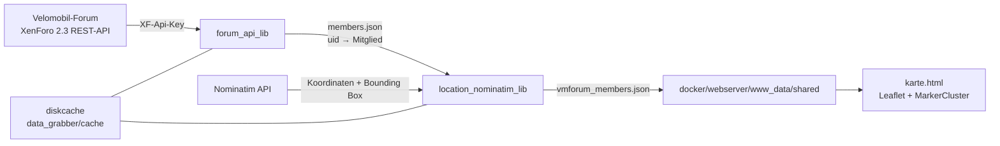

# vmkarte – Codeanalyse und Dokumentation

**Stand:** 31.10.2026
**Gegenstand:** Analyse des bestehenden Codes, Dokumentation der Architektur und Eingrenzung der aktuellen Fehlerursachen.

> **Aktueller Stand 31.10.2026:** Der HTML-Scraper wurde durch einen XenForo-REST-API-Client (`src/data_grabber/libs/forum_api_lib.py`) ersetzt. Die Abschnitte 1 und 9–12 dokumentieren die historische HTML-Scraper-Analyse. Maßgeblich für den aktuellen Betrieb sind die Abschnitte 2–8, 13–18 sowie `README.md`.

---

## 1. Kurzfassung

> **Historischer Stand 22.10.2026 – HTML-Scraper.** Die folgenden Befunde beziehen sich auf den damaligen Scraper und sind nicht mehr für den aktuellen API-Betrieb maßgeblich.

Die Vermutung, dass der „Screen-Grabber“ wegen einer Änderung der Forum-Software nicht mehr funktioniert, konnte **nicht bestätigt** werden.

Live-Prüfung am 22.10.2026:

- Das Forum läuft mit **XenForo 2.3** (`data-xf="2.3"` im HTML).
- Der Login über `index.php?login/login` mit `_xfToken` funktioniert weiterhin.
- Die Mitgliederliste ist nach dem Login abrufbar (HTTP 200).
- Die verwendeten Selektoren existieren weiterhin:
  - `h3.contentRow-header a.username` → 20 Treffer auf Seite 1
  - `div.contentRow-main` / `div.contentRow-lesser` → 20 Treffer
  - `dl.pairs--columns` auf der „Über“-Seite → vorhanden
- Die Paginierung liefert weiterhin Seitenzahlen; aktuell maximal **345 Seiten** (ca. 6.900 Mitglieder).

**Die Hauptursache war eine andere:** Die Nominatim-Abfragen wurden von OpenStreetMap mit **HTTP 403 „Access denied“** abgewiesen, weil beim Request **kein User-Agent** mitgesendet wurde. Das war im Code eindeutig nachvollziehbar und wurde live reproduziert.

Am 22.10.2026 wurde der Arbeitsstand auf den Masterstand (`3c9e3fc`) zurückgesetzt. Die zuvor vorhandenen Debug-Änderungen (Scraper auskommentiert, abweichende Ausgabepfade) sind damit **nicht mehr aktiv**. Sie sind in Befund C und D nur noch als historische Notiz dokumentiert.

Zusätzlich wurden fehlgeschlagene Nominatim-Abfragen als `None` mit einer TTL von 365 Tagen gecacht. Durch das damalige tägliche 1-%-Thinning war die effektive Lebensdauer kürzer, lag aber weiterhin bei Wochen bis Monaten.

**Umgesetzt am 22.10.2026:**

- Nominatim-Requests senden jetzt einen konfigurierbaren, identifizierenden User-Agent und verwenden einen Timeout.
- Nur erfolgreiche Nominatim-Ergebnisse werden dauerhaft gecacht; Fehler und negative Treffer werden zunächst nicht dauerhaft gespeichert (seit 23.10.2026 gibt es einen befristeten Negativ-Cache).
- Ein Hilfsskript zum Leeren des `nominatim`-Caches wurde ergänzt und auf die vorhandenen lokalen Caches angewendet.

**Umgesetzt am 23.10.2026:**

- Die TTL-Bereiche für `user_details` und `nominatim` stehen in der eingecheckten `cache_config.json` und werden pro Eintrag zufällig gezogen.
- Das 1-%-Thinning entfällt; `--fast` wird nur noch aus Kompatibilitätsgründen akzeptiert.
- Jedes Mitglied erhält `profile_updated_at`; die Karte zeigt den Stand im Popup als Datum.
- Erfolgreiche Nominatim-Abfragen ohne Treffer werden 30 Tage negativ gecacht; Exceptions werden nicht gecacht.

---

## 2. Projektzweck

Das Projekt liest Mitgliederdaten aus dem Velomobil-Forum, ermittelt aus der freiwillig angegebenen Ortsangabe Koordinaten über Nominatim/OpenStreetMap und erzeugt daraus eine JSON-Datei. Diese wird von einer statischen Leaflet-Karte im Browser angezeigt.

Bis zum 31.10.2026 handelte es sich nicht um einen Screenshot- oder OCR-basierten „Screen-Grabber“, sondern um einen **HTML-Scraper** mit `requests` und `BeautifulSoup`. Seitdem wird die **XenForo-REST-API** verwendet.

---

## 3. Repository-Struktur

```text
vmkarte/
├── src/data_grabber/
│   ├── data_grabber.py                 # Einstiegspunkt / Orchestrierung
│   ├── config.example.json             # Vorlage für lokale Zugangsdaten
│   ├── cache_config.json               # Konfiguration der Cache-TTLs
│   ├── libs/
│   │   ├── forum_api_lib.py            # XenForo-REST-API-Client
│   │   ├── vehicle_label_lib.py        # Best-Guess-Resolver für Fahrzeuglabels
│   │   ├── vehicle_label_map.json      # API-Optionswert → Anzeigename
│   │   ├── location_nominatim_lib.py   # Nominatim-Abfragen und Radius
│   │   ├── location_mapping_rules_lib.py # Orts-/Länder-/PLZ-Normalisierung
│   │   ├── cache_config_lib.py         # Laden/Validieren der Cache-TTLs
│   │   ├── paths_lib.py                # Einheitliche Laufzeitpfade
│   │   ├── country_mapping.json        # Ländernamen/-kürzel → Ländercode
│   │   └── kuerzel_mapping.json        # Deutsche Kfz-/Ortskürzel → Ortsname
│   ├── tests/
│   │   └── test_vehicle_labels.py      # Tests für Label-Resolver
│   └── utils/
│       ├── clear_nominatim_cache.py    # Löscht den Nominatim-Cache
│       ├── delete_user_cash_entry.py   # Löscht einen user_details-Cacheeintrag
│       └── vehicle_label_map_report.py # Report fehlender Fahrzeuglabels
├── docker/
│   ├── cron/                           # Cron-Container für den Datengrabber
│   └── webserver/                      # nginx + statische Karte
├── docker/webserver/www_data/
│   ├── karte.html                      # Leaflet-Frontend
│   ├── geo-handler.php                 # geo:-Weiterleitung zu BRouter
│   ├── leaflet/                        # Leaflet-Bibliothek
│   ├── markercluster/                  # Marker-Cluster-Plugin
│   └── shared/                         # Kartendaten (Laufzeit, ignoriert)
├── docs/
│   ├── upgrade-docker.md               # Upgrade-Anleitung Docker
│   └── upgrade-native.md               # Upgrade-Anleitung native Installation
├── config/                             # Laufzeitkonfiguration (ignoriert)
├── volumes/                            # Docker-Cache (ignoriert)
├── requirements.txt
├── setup.py
└── docker-compose.yml.sample
```

---

## 4. Architektur und Datenfluss



### Ablauf eines vollständigen Laufs

1. `data_grabber.py` parst die CLI-Parameter; `--fast` wird aus Kompatibilitätsgründen noch akzeptiert, hat aber keine Wirkung mehr.
2. `cache_config_lib.py` lädt die TTL-Bereiche für `user_details` und `nominatim` aus `cache_config.json`.
3. `get_member_data()` ruft die paginierte Benutzerliste über die REST-API ab und ergänzt fehlende Profildaten über `/users/{id}/`.
4. Die Mitgliederdaten werden im `members_dict`-Cache zwischengespeichert.
5. `examine_locations()` normalisiert die Ortsangabe, ermittelt Land und PLZ, fragt Nominatim ab und berechnet einen Radius aus der Bounding Box.
6. Es werden nur Mitglieder mit erfolgreich aufgelöstem Ort übernommen.
7. Die aufbereiteten Datensätze werden als `vmforum_members.json` geschrieben.
8. Die Karte lädt `shared/vmforum_members.json` per `fetch()`.

---

## 5. Komponenten im Detail

### 5.1 `src/data_grabber/data_grabber.py`

Einstiegspunkt und Orchestrierung.

- CLI-Parameter `--fast`: wird aus Kompatibilitätsgründen noch akzeptiert, hat aber keine Wirkung mehr.
- CLI-Parameter `--debug`: schreibt die Rohdaten nach `src/data_grabber/members.json` (Docker: `/app/members.json`). Ohne `--debug` wird diese Datei nicht erzeugt. Für den Normalbetrieb ist `--debug` nicht nötig; die Kartenausgabe ist identisch.
- CLI-Parameter `--refresh-members`: ignoriert den 23-Stunden-Cache `members_dict`, lädt alle Mitgliederseiten neu und ersetzt den Cache. Damit werden auch neu registrierte Benutzer innerhalb des 24-Stunden-Fensters gefunden.
- CLI-Parameter `--refresh-user UID|NAME`: erzwingt einen frischen Profilabruf für einen Benutzer (Bypass von `user_details`). Mehrfach und kommagetrennt möglich. Akzeptiert numerische UIDs oder exakte Forennamen; mehrdeutige Namen führen zu einem Fehler mit den passenden UIDs. Ist das Ziel nicht im aktuellen Mitglieder-Cache, wird die Mitgliederliste automatisch einmal neu geladen. Für dieses Profil wird zusätzlich der Nominatim-Cache nicht gelesen; das frische Ergebnis wird mit neuer TTL gespeichert.
- `--refresh-members` und `--refresh-user` lassen sich kombinieren. Dann stammen auch die Ortsangaben des Zielprofils garantiert aus der frisch geladenen Mitgliederliste.
- Ohne `--debug` werden vorhandene `members.json`-Kopien am aktuellen Pfad sowie im Shared-/Web-Verzeichnis, im alten lokalen `shared/`-Verzeichnis und im Repository-Root gelöscht. Die Datei liegt außerhalb des Web-Roots.
- `get_member_data()` ist aktiv.
- Die Kartenausgabe erfolgt nach `docker/webserver/www_data/shared/vmforum_members.json` (Docker: `/app/shared/vmforum_members.json`).
- Baut aus jedem Mitglied ein reduziertes Objekt mit `id`, `name`, `lat`, `lon`, `radius` und optional `profile_updated_at`, `vm`, `lr`, `tr`, `other`.
- Das frühere Cache-Thinning entfällt; die Verteilung übernimmt die zufällige TTL aus `cache_config.json`.

### 5.2 `src/data_grabber/libs/forum_api_lib.py`

Verantwortlich für Authentifizierung, Paginierung, Feld-Mapping und Caching der Forendaten über die XenForo-REST-API.

**Authentifizierung**

- Sendet `XF-Api-Key` aus `api.api_key`.
- `XF-Api-User` wird nur gesetzt, wenn `api.api_user_id` eine numerische Benutzer-ID ist. Für einen User-Key ist das nicht nötig; ein Super-User-Key kann damit den Kontext setzen.
- `GET /index/` liefert Key-Typ und Scopes; der Client prüft `user:read`.
- Bei `401`/`403` werden klare Fehler ausgegeben, insbesondere wenn die Mitgliederliste für einen Guest-Key gesperrt ist.

**Mitgliederliste**

- `GET /users/?page=N` wird paginiert, bis `pagination.total_pages` erreicht ist.
- Übernommen werden `user_id` → `uid`, `username` → `name`, `location` → `location` und `view_url` → `href`.
- Enthält der jeweilige Listeneintrag `custom_fields`, werden die Fahrzeugfelder direkt daraus gemappt; andernfalls werden die Details für genau diesen Benutzer über `GET /users/{id}/` ergänzt. Die Entscheidung erfolgt pro Benutzer, nicht anhand der ersten Seite.
- Feld-Mapping:
  - `Velomobil` → `vm`
  - `Liegerad` → `lr`
  - `Trike` → `tr`
  - `sonstige Fahrzeuge/Bemerkungen` → `other`
- Die Feld-IDs lassen sich in `api.custom_field_map` fest vorgeben. Ohne Vorgabe werden sie anhand ihrer Namen erkannt.
- Für Auswahlfelder liefert die API interne Optionswerte (z. B. `df_xl`). `libs/vehicle_label_map.json` übersetzt sie in Anzeigenamen (z. B. `DF XL`).
- `libs/vehicle_label_lib.py` löst unbekannte Werte in dieser Reihenfolge: exakter Treffer, normalisierter Treffer (Groß-/Kleinschreibung, `_`/`-`, Umlaute), gleiche Token-Menge, Erweiterung eines bekannten Labels um Zusatz-Tokens, sonst Humanisierung mit gelernter Token-Schreibweise.
- Unbekannte Rohwerte werden im Cache `('vehicle_label_unknown', 'api-v1')` für 90 Tage für den Report gespeichert; humanisierte Werte werden zusätzlich einmal pro Lauf gewarnt.
- Beim Lesen aus `members_dict` und `user_details` werden vorhandene Rohwerte ebenfalls über den Resolver normalisiert.
- `utils/vehicle_label_map_report.py` zeigt fehlende Rohwerte, Trefferzahl, Best Guess, Confidence und Quelle. Mit `--strict` endet das Skript mit Status 1, wenn unbekannte Werte gefunden werden.

**Humanisierung und Token-Schreibweise**

`libs/vehicle_label_lib.py` normalisiert Rohwerte vor dem Vergleich: Umlaute werden ersetzt (`ä` → `ae`, `ö` → `oe`, `ü` → `ue`, `ß` → `ss`), `&` wird zu `amp`, Satzzeichen entfallen, `_`, `-` und Leerzeichen gelten als Trennzeichen.

Die Humanisierung greift erst, wenn exakter, normalisierter, tokenbasierter und erweiterter Treffer fehlschlagen:

- Rohwert an `_`, `-` und Leerzeichen trennen.
- Bekannte Schreibweisen aus vorhandenen Labels übernehmen, z. B. `df` → `DF`, `m5` → `M5`, `waw` → `WAW`, `zox` → `ZOX`.
- `amp` als `&` ausgeben.
- Unbekannte Wörter großschreiben.

| Rohwert | Ergebnis | Methode |
|---|---|---|
| `df_xl` | `DF XL` | exakt |
| `df__xl` | `DF XL` | normalisiert |
| `m5_carbon_high_racer_2024` | `M5 Carbon High Racer 2024` | Erweiterung |
| `z_amp_z_swing_2` | `Z&Z Swing 2` | Erweiterung |
| `neues_modell` | `Neues Modell` | Humanisierung |

Es gibt bewusst kein Fuzzy-Matching. Ähnliche, aber unterschiedliche Modellnamen werden nicht automatisch zusammengeführt. Das vermeidet falsche Treffer wie `Flux S-800` → `Flux S-900`. Unbekannte Rohwerte bleiben im Unknown-Log; humanisierte Werte werden zusätzlich gewarnt.

**Caching**

| Cache-Name | Schlüssel | Laufzeit | Inhalt |
|---|---|---|---|
| `members_dict` | `('members_dict', 'api-v1')` | 23 h | komplettes Mitglieder-Dictionary |
| `user_details` | `('user_details', 'api-v1', uid)` | 7–14 Tage (konfigurierbar) | angereichertes Mitgliedsobjekt inkl. `profile_updated_at` |
| `nominatim` | `('nominatim', searchstring, country_code)` | 180–365 Tage (konfigurierbar) | erfolgreiche Nominatim-Antworten |
| `nominatim` (negativ) | `('nominatim', searchstring, country_code)` | 30 Tage (konfigurierbar) | Sentinel für „erfolgreich abgefragt, kein Treffer“ |

- Der Namespace `api-v1` trennt die API-Caches von den alten HTML-Scraper-Einträgen. Alte Einträge werden ignoriert und laufen mit ihrer bisherigen TTL aus.
- Die TTL wird für jeden neuen Cacheeintrag zufällig aus `cache_config.json` gezogen.
- `--refresh-members` umgeht den `members_dict`-Cache. Ein leeres oder fehlerhaftes Ergebnis wird nicht gecacht.
- `--refresh-user` umgeht `user_details` für die Ziel-UIDs und erzwingt einen Detailabruf.
- Fehlt `custom_fields` in einer Detailantwort, bleiben vorhandene Fahrzeugfelder erhalten und der Eintrag wird nur kurz (1 Tag) gecacht. So kann eine spätere Rechteerweiterung zeitnah greifen.
- Ein 403 bei einem einzelnen Profil bricht den Lauf nicht ab: Der Client gibt eine Warnung aus, behält die vorhandenen Daten und cacht sie kurz. Ein 403 auf die Mitgliederliste bleibt ein harter Fehler.
- Exceptions und API-Fehler werden nicht als erfolgreiche Cacheeinträge gespeichert.

**Grenzen**

- Die API muss die Mitgliederliste und Profile für den Key-Kontext freigeben. Ein Guest-Key mit `user:read` reicht nicht aus, wenn Gäste die Mitgliederliste nicht sehen dürfen.
- `custom_fields` sind nur verfügbar, wenn der Key-Kontext die Profilfelder sehen darf.
- XenForo stellt keinen API-Endpunkt für die Definitionsdaten der Profilfelder bereit. Die sichtbaren Labels von Auswahlfeldern kommen daher aus `vehicle_label_map.json` und dem Best-Guess-Resolver, nicht direkt aus der API.

### 5.3 `src/data_grabber/libs/location_nominatim_lib.py`

**`query_nominatim(searchstring, country_code, use_cache=True)`**

- Entfernt führende/abschließende Kommas und Leerzeichen.
- Entfernt bei vorhandenem Ländercode ein Präfix wie `d-90469`.
- Prüft bei `use_cache=True` den lokalen Cache. Mit `use_cache=False` wird der Cache nicht gelesen; das frische Ergebnis wird trotzdem gespeichert.
- Baut die URL:
  `https://nominatim.openstreetmap.org/search?q=...&format=json&addressdetails=1&email=...&countrycodes=...`
- Sendet den Request mit `NOMINATIM_HEADERS` (konfigurierbarer User-Agent) und `NOMINATIM_TIMEOUT` (`location_nominatim_lib.py:46`).
- Bei genau einem Treffer wird ein zweiter Request mit `exclude_place_ids` ausgeführt (`location_nominatim_lib.py:105`), ebenfalls mit Header und Timeout.
- Bevorzugt bestimmte OSM-Typen (PLZ, administrative Grenzen, Stadt, Dorf usw.).
- Gibt `None` zurück, wenn kein Treffer oder ein Request-Fehler auftritt.
- Cacht erfolgreiche Treffer mit der positiven TTL (Default 180–365 Tage, zufällig pro Eintrag).
- Cacht „erfolgreich abgefragt, aber kein Treffer“ mit `negative_ttl_days` (Default 30 Tage).
- **Exceptions** (HTTP 403/429, Timeouts, JSON-Fehler) werden nicht gecacht, damit temporäre Störungen den Cache nicht vergiften.

**`calculate_radius(boundingbox)`**

- Berechnet die geodätische Distanz von der Bounding-Box-Mitte zur Nordwest-Ecke.
- Gibt einen gerundeten Radius in Metern oder `'N/A'` zurück.

**`examine_locations(members, refresh_uids=())`**

- Iteriert über das Dictionary `uid → Mitglied`.
- Normalisiert den Ort, ermittelt Land/PLZ.
- Probiert bei unbekanntem Land verschiedene Ländercode-Kombinationen.
- Für UIDs in `refresh_uids` werden alle Nominatim-Abfragen mit `use_cache=False` ausgeführt. Alle anderen Mitglieder nutzen den Cache unverändert.
- Übernimmt `lat`, `lon`, `radius` nur bei erfolgreicher Nominatim-Antwort.
- Mitglieder ohne Ortsangabe oder ohne Nominatim-Treffer werden nicht in die Ausgabe übernommen.

### 5.4 `src/data_grabber/libs/location_mapping_rules_lib.py`

- Lädt `country_mapping.json` und `kuerzel_mapping.json`.
- `prepare_location()` bereinigt Ortsangaben:
  - Kleinschreibung, Whitespace-Normalisierung
  - Entfernen von Füllwörtern wie „bei“, „nähe“, „von“, „in“
  - Ersetzen zahlreicher Sonderfälle (z. B. „black forest“ → „schwarzwald“)
  - Auflösen deutscher Kürzel (z. B. `A` → `Augsburg`)
- `analyze_location_for_country()` erkennt Ländernamen und Kürzel.
- `analyze_location_for_postal_code()` sucht 4- bis 5-stellige Zahlen.

### 5.5 Cache-Verwaltung und Cache-Konfiguration

- `cache_config_lib.load_cache_config()` liest `cache_config.json` relativ zum `data_grabber`-Verzeichnis.
- Fehlende Datei oder fehlende Werte führen zu den Defaults; ungültige Werte lösen eine klare `ValueError`-Meldung aus.
- `get_ttl_seconds(cache_name)` zieht bei jedem Cache-Schreibvorgang eine zufällige TTL aus dem konfigurierten Bereich.
- `get_negative_ttl_seconds(cache_name)` liefert die TTL für negative Nominatim-Treffer (Default 30 Tage; `0` deaktiviert den Negativ-Cache).
- Das frühere `cache_thinning_lib.delete_random_cache_data()` und der 1-%-Thinning-Aufruf sind entfallen. Die Verteilung erfolgt über die zufällige TTL.
- `--fast` wird zwar noch akzeptiert, hat aber keine Wirkung mehr.
- `--refresh-members` und `--refresh-user` ergänzen die Cache-Verwaltung um einen gezielten Bypass, ohne die Cache-Schlüssel oder TTL-Bereiche zu verändern. `--refresh-user` benötigt kein separates Nominatim-Flag: Der Orts-Cache wird für die Ziel-UID automatisch nicht gelesen.
- `utils/cache.py` wurde entfernt. Die verbleibenden Hilfsskripte sind `utils/clear_nominatim_cache.py` und `utils/delete_user_cash_entry.py`.
- `utils/delete_user_cash_entry.py` löscht den API-Key `('user_details', 'api-v1', uid)` und den alten HTML-Key `('user_details', uid)` relativ zum Skriptpfad.

### 5.6 Frontend `karte.html`

- Lädt `shared/vmforum_members.json` (`karte.html:47`).
- Erstellt eine Leaflet-Karte mit MarkerCluster.
- Zeigt die vorgeschriebene Attribution im Leaflet-Attribution-Control unten rechts: „© OpenStreetMap-Mitwirkende, ODbL“ sowie „Geocoding: Nominatim“.
- Filtert nach URL-Parametern und Formularfeldern.
- Zeigt Name, Velomobil, Liegerad, Trike, Freitext/Hashtags und den Stand der Profildaten im Popup.
- Der Stand wird als Datum (`TT.MM.JJJJ`) aus `profile_updated_at` angezeigt; der exakte Zeitstempel steht im Tooltip. Fehlt der Wert, erscheint `Stand: unbekannt`.
- Nutzt `radius` beim Hover, um die Unsicherheit der Ortsauflösung als Kreis darzustellen.
- Registriert einen `geo:`-Protokollhandler, der auf `christoph-moder.de/vmforum-karte/geo-handler.php` verweist.
- Es gibt keine Fehlerbehandlung, falls `fetch()` fehlschlägt; die Karte initialisiert dann nicht.

### 5.7 Docker-Setup

**Cron-Container** (`docker/cron/Dockerfile`)

- Basis: `python:3.14-slim`
- Kopiert:
  - `src/data_grabber/data_grabber.py` → `/app/data_grabber.py`
  - `src/data_grabber/libs/*` → `/app/libs/`
  - `src/data_grabber/utils/*` → `/app/utils/`
  - `src/data_grabber/cache_config.json` → `/app/cache_config.json` (Default, wird durch den Compose-Mount überschrieben)
- **Kopiert bewusst nicht** `members.json` oder `vmforum_members.json`. Beide Dateien sind Laufzeitartefakte: `members.json` entsteht durch `get_member_data()`, `vmforum_members.json` durch `examine_locations()`.
- Voraussetzung dafür ist, dass der Scraper aktiv ist. Das ist seit der Rückkehr zum Masterstand wieder der Fall; siehe Befund C.
- Cronjob: täglich 03:33 Uhr, `cd /app && python3 /app/data_grabber.py --fast` (`docker/cron/crontab:5`). `--fast` hat inzwischen keine Wirkung mehr.

**Web-Container** (`docker/webserver`)

- nginx mit Basic Auth.
- Dokumentwurzel `/www_data`, Startseite `karte.html`.
- `./docker/webserver/www_data/shared` wird read-only nach `/www_data/shared` gemountet.
- `members.json` wird per `location ~ /members\.json$ { return 404; }` grundsätzlich nicht ausgeliefert.

**Compose** (`docker-compose.yml.sample`)

- Cron mountet:
  - `./config/config.json` → `/app/config.json`
  - `./config/cache_config.json` → `/app/cache_config.json` (read-only)
  - `./volumes/cron/cache` → `/app/cache`
  - `./docker/webserver/www_data/shared` → `/app/shared`
- Web mountet:
  - `./docker/webserver/www_data/shared` → `/www_data/shared`

Damit die Karte aktualisiert wird, muss der Cron-Container zwingend nach `/app/shared/vmforum_members.json` schreiben. Derselbe Host-Pfad wird auch vom Web-Container gelesen. IDE und native Installation schreiben standardmäßig direkt nach `<repo>/docker/webserver/www_data/shared`.

---

## 6. Datenformate

### 6.1 Eingabe / Zwischenstand `members.json`

Wird nur mit `--debug` geschrieben und enthält personenbezogene Rohdaten. Ohne `--debug` wird die Datei nicht erzeugt; vorhandene Kopien im Web-/Shared-Verzeichnis werden entfernt.

Objekt, keyed nach `uid`:

```json
{
  "999999": {
    "uid": "999999",
    "name": "pr0meteus",
    "href": "/forum/index.php?members/pr0meteus.999999/",
    "location": "12345 Musterstadt",
    "lr": "Beispielliegerad"
  }
}
```

Die UID, der Ortsname und das Fahrzeug sind fiktive Beispieldaten. Optionale Felder: `location`, `profile_updated_at`, `vm`, `lr`, `tr`, `other`.

### 6.2 Ausgabe `vmforum_members.json`

Array:

```json
[
  {
    "id": "999999",
    "name": "pr0meteus",
    "lat": "50.000000",
    "lon": "10.000000",
    "radius": 2500,
    "profile_updated_at": "2026-10-23T03:35:12+02:00",
    "lr": "Beispielliegerad"
  }
]
```

Hinweise:

- `lat`/`lon` sind Strings, wie sie Nominatim liefert.
- `radius` ist eine Ganzzahl in Metern oder `'N/A'`.
- `profile_updated_at` ist der Zeitpunkt des letzten erfolgreichen Profilabrufs als ISO-8601-String mit lokaler Zeitzone. Das Feld fehlt, wenn das Profil noch nie erfolgreich geladen wurde; die Karte zeigt dann `Stand: unbekannt`.
- Nur Mitglieder mit nicht-leerer Ortsangabe und erfolgreichem Nominatim-Treffer werden aufgenommen.
- Bei ca. 6.948 Mitgliedern enthielten die vorhandenen Ausgabedateien ca. 3.167 Einträge mit Koordinaten.

### 6.3 Algorithmus: Vom Profileintrag zu Koordinaten

#### Kurz erklärt

Die Karte verwendet nicht die Wohnadresse, sondern die freiwillige Ortsangabe aus dem Forenprofil. Diese Angabe ist Freitext und wird in mehreren Schritten normalisiert, auf Land und Postleitzahl geprüft und anschließend an Nominatim/OpenStreetMap übergeben. Aus dem besten Treffer werden Breiten- und Längengrad sowie ein grober Radius berechnet. Nur Mitglieder mit einer erfolgreich aufgelösten Ortsangabe erscheinen auf der Karte.

#### Technischer Ablauf

1. **Ort aus der Mitgliederliste lesen**

   Der API-Client liest über `GET /users/` den Benutzernamen, die `user_id`, den Profil-Link (`view_url`) und – falls vorhanden – `location`. Die Ortsangabe ist Freitext, z. B. `90469 Nürnberg`, `Wien` oder `bei Hamburg`.

   Die Fahrzeugfelder `Velomobil`, `Liegerad`, `Trike` und `sonstige Fahrzeuge/Bemerkungen` kommen aus `custom_fields` des Profils. Falls die Mitgliederliste diese Felder nicht enthält, werden sie über `GET /users/{id}/` ergänzt. Sie werden nicht für das Geocoding verwendet, sondern nur in der Karte angezeigt und gefiltert.

2. **Ortsangabe normalisieren**

   `prepare_location()` in `location_mapping_rules_lib.py` bereinigt den Text:

   - Kleinschreibung und Vereinheitlichung von Leerzeichen.
   - Entfernen führender Füllwörter wie `bei`, `nähe`, `nahe`, `von`, `in`, `im`, `der`.
   - Ersetzen bekannter Sonderfälle, z. B. `black forest` → `schwarzwald`, `s-h` → `schleswig-holstein`, `südhessen` → `hessen`.
   - `kreis` wird in bestimmten Kontexten zu `landkreis`; `großraum` und `umland` werden entfernt.
   - Kombinationen aus Postleitzahl und Kürzel werden über `kuerzel_mapping.json` aufgelöst, z. B. `90469 n` → `90469 nürnberg`.
   - Besteht die gesamte Angabe nur aus einem 1- bis 3-Buchstaben-Kürzel, wird sie ebenfalls über `kuerzel_mapping.json` ersetzt, z. B. `A` → `Augsburg`.
   - Allgemeine Angaben wie `hier`, `norden`, `süden`, `zentral` oder rein numerische Kurzangaben werden verworfen.

3. **Land und Postleitzahl erkennen**

   `analyze_location_for_country()` sucht nach einem Ländercode oder Ländernamen. Dafür wird `country_mapping.json` verwendet. Das Format `d-90469 ...` wird als deutsches Kürzel erkannt. Zusätzlich enthält das Mapping einige Städte, z. B. Wien für Österreich oder Zürich für die Schweiz. Wird im ursprünglichen Text kein Land erkannt, versucht der Code es nach der Normalisierung erneut.

   `analyze_location_for_postal_code()` sucht die erste vier- oder fünfstellige Zahl und verwendet sie als Postleitzahl.

4. **Suchstrategie festlegen**

   Ist ein Land bekannt, wird direkt mit diesem Ländercode gesucht. Sonst probiert der Code mehrere plausible Länderkombinationen durch und nimmt den ersten Treffer:

   - fünfstellige Postleitzahl: `de`, dann `fr,fi,it`, dann ohne Länderfilter
   - sonstige Postleitzahl: `at,ch`, dann `dk,nl`, dann ohne Länderfilter
   - keine Postleitzahl: `de,at,ch`, dann ohne Länderfilter

   Diese Reihenfolge ist auf die überwiegend deutschsprachige Forengemeinde zugeschnitten.

5. **Nominatim abfragen**

   `query_nominatim()` entfernt zunächst ein eventuell vorhandenes Länderpräfix wie `d-` und prüft den lokalen Cache. Nur erfolgreiche Ergebnisse werden gespeichert. Danach wird die Anfrage an

   ```text
   https://nominatim.openstreetmap.org/search?q=<Ort>&format=json&addressdetails=1&email=<konfiguriert>&countrycodes=<Land>
   ```

   gesendet. Die Anfrage enthält einen konfigurierbaren User-Agent und einen Timeout; zwischen zwei Anfragen wird mindestens eine Sekunde gewartet.

   Liefert Nominatim genau einen Treffer, wird ein zweiter Request mit `exclude_place_ids` ausgeführt. Damit werden Alternativen sichtbar, die Nominatim sonst hinter dem ersten Treffer zurückhält.

6. **Besten Treffer auswählen**

   Die Treffer werden nicht einfach in der Reihenfolge von Nominatim übernommen. Der Code bevorzugt bestimmte OSM-Typen in dieser Reihenfolge:

   ```text
   postal_code, administrative, post_box, city, town, village, suburb,
   region, hamlet, political, protected_area, county, government,
   residential, ceremonial, island, station, post_office,
   motorway_junction, bus_stop
   ```

   Der erste Treffer, dessen `type` in dieser Liste am weitesten vorn steht, gewinnt. Gibt es keinen passenden Typ, wird der erste Treffer verwendet.

7. **Koordinaten und Radius berechnen**

   Aus dem gewählten Treffer werden `lat` und `lon` übernommen. Für den Radius wird die Bounding Box `[south, north, west, east]` verwendet:

   - Mittelpunkt: `((south + north) / 2, (west + east) / 2)`
   - Nordwest-Ecke: `(north, west)`
   - Radius: geodätische Distanz zwischen Mittelpunkt und Nordwest-Ecke in Metern

   Der Radius ist damit ein grober Anhaltspunkt für die Ausdehnung des gefundenen Gebiets, keine exakte Genauigkeitsangabe.

8. **Filtern und ausgeben**

   Mitglieder ohne Ortsangabe oder ohne Nominatim-Treffer werden übersprungen. Für die übrigen entsteht ein Datensatz mit `id`, `name`, `lat`, `lon`, `radius` und optional `vm`, `lr`, `tr`, `other`. Die Karte setzt den Marker auf `lat`/`lon` und zeigt den Radius beim Hover als Kreis.

#### Beispiele

| Profileintrag | Verarbeitung | Ergebnis |
|---|---|---|
| `90469 Nürnberg` | PLZ 90469 erkannt, Land unbekannt, Versuch mit `de` | Koordinaten von Nürnberg |
| `A` | Kürzel `A` → `Augsburg`, kein Land/PLZ, Versuch mit `de,at,ch` | Koordinaten von Augsburg |
| `Wien` | `Wien` ist im Länder-Mapping Österreich zugeordnet | Koordinaten von Wien |
| `d-90469 Nürnberg` | Präfix `d` → Land `de`, Präfix wird vor der Abfrage entfernt | Koordinaten von Nürnberg |
| `irgendwo` | kein Land, keine PLZ, mehrere Versuche ohne eindeutigen Treffer | wird nicht auf die Karte aufgenommen |

#### Grenzen und Besonderheiten

- Die Ortsangabe ist Freitext. Der Algorithmus ist eine Heuristik und garantiert keine korrekte Zuordnung.
- `country_mapping.json` enthält derzeit 27 Länder; `kuerzel_mapping.json` enthält 452 deutsche Orts- und Regionalkürzel. Orte außerhalb dieser Listen können fehlschlagen oder falsch interpretiert werden.
- Die Typ-Priorisierung bevorzugt größere Einheiten wie Postleitzahlen, Verwaltungsgebiete und Städte. Exakte Hausadressen sind dadurch unwahrscheinlicher, aber nicht ausgeschlossen.
- Der Marker liegt auf dem gefundenen Nominatim-Punkt, häufig auf einem Stadt- oder PLZ-Zentrum. Das ist nicht zwingend die tatsächliche Wohnadresse.
- Der Radius ist die halbe Diagonale der Bounding Box und keine echte Fehlertoleranz.
- Der Ort wird zusammen mit den Profildaten über `user_details` gecacht (Default 7–14 Tage). Ändert ein Mitglied seinen Ort, kann die Karte daher bis zu 14 Tage lang den alten Ort anzeigen. Der angezeigte `profile_updated_at`-Stand gilt für dieses komplette gecachte Mitgliedsobjekt einschließlich Ortsangabe. Mit `--refresh-user UID|NAME` lässt sich dieses Mitgliedsobjekt gezielt und sofort erneuern; für die frische Ortsangabe zusätzlich `--refresh-members` verwenden.
- Positive Nominatim-Ergebnisse werden standardmäßig 180–365 Tage gecacht. Erfolgreiche Abfragen ohne Treffer werden 30 Tage negativ gecacht. Beide Werte sind über `cache_config.json` konfigurierbar; Exceptions werden nicht gecacht.
- Durch die zufällige TTL laufen nicht alle Profile am selben Tag ab; die Aktualisierungen verteilen sich über den konfigurierten Zeitraum.
- Die API kann `location` als `null` oder als Nicht-String liefern. `_extract_location()` behandelt das als leere Ortsangabe; solche Mitglieder werden nicht geocodiert.

---

## 7. Konfiguration

`config.json` im `data_grabber`-Verzeichnis (script-relativ):

```json
{
  "email": "email-address-for-nominatim",
  "nominatim_user_agent": "vmkarte/2.0 (+https://github.com/juefried/vmkarte)",
  "api": {
    "base_url": "https://www.velomobilforum.de/forum/index.php?api/",
    "api_key": "your-forum-api-key",
    "custom_field_map": {
      "vm": "",
      "lr": "",
      "tr": "",
      "other": ""
    }
  }
}
```

`api.base_url` ist die von der Forum-Administration bereitgestellte API-URL. `api.api_key` wird als `XF-Api-Key` gesendet. Der Key benötigt `user:read` und muss die Mitgliederliste sowie Profile sehen dürfen. Für einen Super-User-Key kann optional `api.api_user_id` als numerische Benutzer-ID gesetzt werden; für einen User-Key ist das nicht erforderlich.

Empfohlen ist ein **dedizierter User-Key** für ein Lese-/Bot-Konto. Er ist an genau dieses Konto gebunden, benötigt keinen `XF-Api-User`-Kontext und lässt sich leichter widerrufen. Ein Super-User-Key mit `api_bypass_permissions=1` ist mächtiger als nötig und sollte nur verwendet werden, wenn der Betreiber keinen User-Key bereitstellen möchte.

`nominatim_user_agent` ist optional. Die Auflösung erfolgt in dieser Reihenfolge:

1. Umgebungsvariable `NOMINATIM_USER_AGENT`
2. `nominatim_user_agent` aus `config.json`
3. Standardwert `vmkarte/2.0 (+https://github.com/juefried/vmkarte)`

Für einen öffentlichen Betrieb oder einen Fork sollte jede Instanz einen eigenen User-Agent mit Kontaktangabe setzen, z. B. `meine-vmkarte/2.0 (+https://example.org; admin@example.org)`. Der Wert wird beim Import gelesen; Änderungen benötigen einen Neustart.

### Cache-TTLs in `cache_config.json`

Die TTL-Bereiche für `user_details` und `nominatim` stehen in `cache_config.json`:

```json
{
  "user_details": {
    "ttl_days_min": 7,
    "ttl_days_max": 14
  },
  "nominatim": {
    "ttl_days_min": 180,
    "ttl_days_max": 365,
    "negative_ttl_days": 30
  }
}
```

- Die Datei wird relativ zum `data_grabber`-Verzeichnis gesucht, nicht relativ zum Arbeitsverzeichnis.
- Fehlt die Datei oder ein Wert, gelten die oben genannten Defaults.
- `ttl_days_min == ttl_days_max` ergibt eine feste TTL.
- Werte müssen Zahlen größer 0 sein; `ttl_days_max` darf nicht kleiner als `ttl_days_min` sein. `negative_ttl_days` darf 0 sein (deaktiviert den Negativ-Cache). Ungültige Werte brechen den Lauf mit einer klaren Fehlermeldung ab.
- Die positive TTL wird bei jedem neuen Cacheeintrag zufällig im Bereich gezogen. Änderungen greifen beim nächsten Prozessstart, also beim nächsten Cron-Lauf.
- `negative_ttl_days` gilt für erfolgreiche Abfragen ohne Treffer. Exceptions werden nicht gecacht.
- Die Datei enthält keine Zugangsdaten und ist deshalb eingecheckt.

Vorlagen:

- `src/data_grabber/config.example.json` für lokale Zugangsdaten
- `src/data_grabber/cache_config.json` für lokale Cache-TTLs (eingecheckt)
- `config/config.json.sample` für Docker-Zugangsdaten
- `config/cache_config.json.sample` für Docker-Cache-TTLs

### Pfade

`libs/paths_lib.py` löst alle Laufzeitpfade script-relativ auf:

| Zweck | Lokal / IDE / native Installation | Docker |
|---|---|---|
| `config.json` | `src/data_grabber/config.json` | `/app/config.json` |
| `cache_config.json` | `src/data_grabber/cache_config.json` | `/app/cache_config.json` |
| Cache | `src/data_grabber/cache/` | `/app/cache/` |
| Debug-`members.json` | `src/data_grabber/members.json` | `/app/members.json` |
| Karten-JSON | `<repo>/docker/webserver/www_data/shared/vmforum_members.json` | `/app/shared/vmforum_members.json` |

Damit sucht die IDE dieselben Dateien wie die native Installation, und der Web-Root `docker/webserver/www_data` enthält die Kartendaten direkt. In Docker werden die Container-Pfade über Compose auf denselben Host-Pfad `docker/webserver/www_data/shared` gemountet.

Der Karten-Datenpfad kann mit der Umgebungsvariable `VMKARTE_SHARED_DIR` überschrieben werden. Das ist für native Installationen mit einem separaten Web-Root nützlich:

```bash
export VMKARTE_SHARED_DIR=/var/www/vmforum-karte/shared
```

Ohne Override gilt: Wenn `<repo>/docker/webserver/www_data` existiert, wird `<repo>/docker/webserver/www_data/shared` verwendet; andernfalls `<data_grabber>/shared` (Fallback für das Docker-Image).

---

## 8. Betrieb

Upgrade-Anleitungen: [Docker](docs/upgrade-docker.md) · [native Installation](docs/upgrade-native.md)

### Lokal

```bash
cd src/data_grabber
python -m venv .venv
.venv\Scripts\activate
pip install -r ..\..\requirements.txt
copy config.example.json config.json
python data_grabber.py
```

`cache_config.json` ist bereits eingecheckt und wird script-relativ gefunden. Fehlt sie, gelten die Defaults.

Die Kartenausgabe erfolgt script-relativ nach `docker/webserver/www_data/shared/vmforum_members.json`. Das Verzeichnis wird bei Bedarf angelegt und ist im Repository ignoriert. Die Rohdaten in `members.json` werden nur mit `--debug` geschrieben:

```bash
python data_grabber.py --debug
```

Ohne `--debug` wird eine vorhandene `members.json` gelöscht. Der Debug-Lauf ist nur zur Kontrolle der Rohdaten nötig; die Laufzeit wird vor allem von neuen Nominatim-Abfragen bestimmt. Mit gefülltem Cache ist ein erneuter Lauf deutlich schneller.

### Gezielte Aktualisierung

```bash
# Mitgliederliste neu laden (neue Benutzer sofort finden)
python data_grabber.py --refresh-members

# Profil und Ort eines Benutzers sofort aktualisieren
python data_grabber.py --refresh-user 12345

# Mehrere Benutzer, per UID oder exaktem Forennamen
python data_grabber.py --refresh-user 12345,67890
python data_grabber.py --refresh-user "Max Mustermann"

# Zusätzlich frische Ortsangabe aus der Mitgliederliste
python data_grabber.py --refresh-members --refresh-user 12345
```

Ein gezielter Lauf schreibt weiterhin die vollständige `vmforum_members.json`. Alle nicht betroffenen Mitglieder werden aus den bestehenden Caches bedient. Kann ein Ziel nicht aufgelöst werden, wird die Mitgliederliste einmalig neu geladen; bleibt es unauffindbar oder mehrdeutig, bricht der Lauf mit einer Meldung ab. Wird der Profilabruf oder die Nominatim-Abfrage für das Ziel nicht erfolgreich abgeschlossen, gelten die bisherigen Regeln: Es werden keine neuen Fahrzeugdaten gesetzt bzw. das Mitglied wird ohne aufgelösten Ort nicht in die Kartenausgabe übernommen.

### Schneller Test in der IDE

`src/data_grabber/smoke_test.py` prüft API-Index, ein Einzelprofil, eine Mitgliederlistenseite, zwei Profilabrufe und zwei Nominatim-Abfragen, ohne die produktiven Ausgabedateien zu überschreiben:

```powershell
cd src/data_grabber
python smoke_test.py
```

Die Pfade werden script-relativ aufgelöst; der Test kann aus `src/data_grabber` oder über den vollständigen Pfad gestartet werden. Der Test dauert wenige Sekunden.

### Fahrzeuglabel-Report

```powershell
cd src/data_grabber
python utils/vehicle_label_map_report.py
```

Der Report liest den Mitglieder-Cache und die Liste unbekannter Werte. Er verändert keine Dateien. `--json` liefert maschinenlesbare Ausgabe, `--strict` beendet mit Status 1, sobald unbekannte Werte vorhanden sind.

### Mappingtabelle aktualisieren

1. Report im Verzeichnis `src/data_grabber` ausführen:

   ```powershell
   python utils/vehicle_label_map_report.py
   ```

2. Für jeden offenen Wert das Feld (`vm`, `lr`, `tr`) und den Rohwert notieren.

3. In `libs/vehicle_label_map.json` unter dem passenden Feld ergänzen. Ausschnitt:

   ```json
   {
     "lr": {
       "neues_modell": "Neues Modell"
     }
   }
   ```

   Der Schlüssel ist der API-Rohwert, der Wert der Anzeigename.

4. JSON validieren:

   ```powershell
   python -c "import json; json.load(open('libs/vehicle_label_map.json', encoding='utf-8'))"
   ```

5. Report streng prüfen:

   ```powershell
   python utils/vehicle_label_map_report.py --strict
   ```

   Erwartet: `Unknown values: 0` für die ergänzten Werte.

6. Tests ausführen:

   ```powershell
   python -m unittest discover -s tests -p "test_*.py"
   ```

7. Die Map-Datei committen. Ein Cache-Löschen ist nicht nötig: Der Resolver normalisiert vorhandene Rohwerte beim Lesen; der nächste Prozess lädt die Map neu. Alte Unknown-Log-Einträge bleiben, der Report filtert bereits bekannte Werte.

Im Docker-Betrieb liegt die Map im Image unter `/app/libs/vehicle_label_map.json`. Änderungen daher im Repository vornehmen und `docker compose build` sowie `docker compose up -d` ausführen. Der Report läuft im Container mit:

```powershell
docker compose exec cron python3 /app/utils/vehicle_label_map_report.py
```

### Karte in der IDE anzeigen

Der Scraper schreibt die Kartendaten direkt nach `docker/webserver/www_data/shared/vmforum_members.json`. Damit entfällt das bisherige Kopieren nach jedem Lauf. `docker/webserver/www_data/karte.html` über den IDE-Webserver öffnen und mit `Strg+F5` neu laden.

Fehlt die Datei, bricht `create_map()` beim `await members` ab und es bleibt eine leere Seite. Der Ordner ist in `.gitignore` eingetragen und über `docker/webserver/.dockerignore` vom Web-Image ausgeschlossen.

### Docker

```bash
copy docker-compose.yml.sample docker-compose.yml
copy config\config.json.sample config\config.json
copy config\cache_config.json.sample config\cache_config.json
copy config\.htpasswd.sample config\.htpasswd
docker compose build
docker compose up -d
```

Die Datei `config/cache_config.json` wird read-only nach `/app/cache_config.json` gemountet. Fehlt sie oder ist der Mount-Pfad keine reguläre Datei, greifen die Default-Werte aus `cache_config_lib.py`.

Cron und Web mounten beide `./docker/webserver/www_data/shared` (nach `/app/shared` bzw. `/www_data/shared`). Dadurch schreibt der Scraper direkt in das Verzeichnis, aus dem die Karte liest.

### 8.3 Zwei-Server-Betrieb (Docker und Systeminstallation)

Geplanter Betrieb: ein Server im Docker-Container, ein zweiter Server direkt auf dem System. Beide scrapen unabhängig.

**Konsequenzen:**

- Jede Instanz benötigt eine eigene `config.json`, ein eigenes `cache/`-Verzeichnis und ein beschreibbares Ausgabeverzeichnis. Die Caches werden **nicht** zwischen den Servern geteilt.
- Der jeweils erste Lauf ist teuer: ca. 345 Mitgliederseiten plus bis zu ca. 6.900 Profilabrufe. Die Laufzeiten sollten versetzt starten (z. B. 03:33 und 04:33), damit Forum und Nominatim nicht gleichzeitig belastet werden.
- Beide Instanzen benötigen einen API-Key mit Lesezugriff auf Mitgliederliste und Profile. Ob derselbe Key auf beiden Servern verwendet werden darf, muss mit dem Forenbetreiber geklärt werden; die Läufe sollten zeitlich versetzt starten, um die API nicht gleichzeitig zu belasten.
- Damit der Cache die Laufzeit tatsächlich reduziert, müssen die TTLs größer als das jeweilige Cron-Intervall sein. `user_details` (Default 7–14 Tage) und `nominatim` (Default 180–365 Tage) tun das. `members_dict` (23 h) ist bewusst eine Entwicklungshilfe und im täglichen Cron-Betrieb wirkungslos.
- Beide Server sollten dieselbe `cache_config.json` verwenden, damit die Lastverteilung vergleichbar ist. Die zufällige TTL glättet die Profilabrufe über die Zeit, statt sie in einem 14-Tage-Burst zu bündeln.
- Jede Instanz fragt Nominatim selbst ab. Der Rate-Limit von 1 Request/Sekunde gilt pro Instanz und sollte eingehalten werden. Beide Instanzen brauchen einen identifizierbaren User-Agent mit Kontaktangabe; dieser kann pro Server über `config.json` oder `NOMINATIM_USER_AGENT` gesetzt werden.
- Auf dem zweiten Server schreibt der Scraper standardmäßig nach `<repo>/docker/webserver/www_data/shared`. Für einen separaten Web-Root kann `VMKARTE_SHARED_DIR` auf das Verzeichnis gesetzt werden, das der Webserver als `shared` ausliefert.
- Logging unterscheidet sich: Docker über `docker logs`, Systeminstallation über Cron-Mail, systemd-Journal oder eine Logdatei. Ohne Benachrichtigung bleiben Fehler leicht unbemerkt.
- Das Docker-Image basiert auf Python 3.14 und entspricht damit der lokal getesteten Version. Python 3.9 ist seit Oktober 2025 End-of-Life und sollte nicht mehr verwendet werden. Die Systeminstallation sollte eine gemeinsam getestete, aktuelle Python-Version verwenden.

---

## 9. Fehleranalyse

### Befund A – Nominatim blockierte alle neuen Abfragen (behoben am 22.10.2026)

**Symptom (vor dem Fix):** Für neue oder noch nicht gecachte Orte wurden keine Koordinaten ermittelt. Im Log erschien:

```text
An error occurred while fetching location details for "...", country_code=...:
403 Client Error: Forbidden for url: https://nominatim.openstreetmap.org/search?...
```

**Ursache:**

`query_nominatim()` sendete bei beiden Requests keinen `User-Agent`:

```python
response = requests.get(url)
response_exclude = requests.get(url_exclude)
```

`requests` verwendet dann `python-requests/<version>`. Nominatim verweigert das gemäß seiner Usage Policy mit HTTP 403.

**Live-Nachweis:**

```text
User-Agent: python-requests/2.32.5  → HTTP 403
User-Agent: Browser-ähnlich         → HTTP 200
```

Auch der direkte Aufruf der Projektfunktion reproduzierte den Fehler:

```text
query_nominatim("Qeqertarsuaq", "gl")
→ 403 Client Error: Forbidden
→ Rückgabe: None
```

**Fix:**

- `NOMINATIM_HEADERS` mit identifizierendem User-Agent (`vmkarte/1.0 (+https://github.com/juefried/vmkarte)`) und `Accept: application/json`.
- `NOMINATIM_TIMEOUT = 30` Sekunden.
- Neuer Helper `_get_nominatim()`, der bei jedem Request Header und Timeout setzt und die 1-Request/Sekunde-Regel einhält.
- Beide Requests in `query_nominatim()` verwenden diesen Helper.

**Verifikation:** `query_nominatim("Qeqertarsuaq", "gl")` liefert wieder einen Treffer; der zweite Aufruf kommt ohne Netzwerkzugriff aus dem Cache.

### Befund B – Fehlgeschlagene Nominatim-Abfragen wurden 365 Tage gecacht (behoben am 22.10.2026)

**Ursache (vor dem Fix):** `query_nominatim` war mit `@cache.memoize(name='nominatim', expire=60*60*24*365-60*60)` dekoriert. Die Funktion fing Request-Fehler ab und gab `None` zurück. Diskcache speicherte auch `None` als Ergebnis.

Verifiziert mit einem separaten Diskcache-Test:

```text
f('a') → None
f('a') → None, Funktion wurde nur einmal aufgerufen
Cache-Key vorhanden: ('t', 'a', None)
```

**Konsequenz:** Alle während der 403-Phase fehlgeschlagenen Orte waren als „nicht auflösbar“ gecacht. Die TTL betrug 365 Tage; durch das tägliche 1-%-Thinning war die erwartete Lebensdauer kürzer (bei 1 % Löschwahrscheinlichkeit pro Tag im Mittel ca. 100 Tage).

**Fix:**

- `@cache.memoize` wurde durch manuelles Caching ersetzt.
- Cache-Schlüssel: `('nominatim', searchstring, country_code)`.
- `cache.set()` wird bei einem Treffer aufgerufen. Seit 23.10.2026 wird „kein Treffer“ zusätzlich mit einer kurzen Negativ-TTL gecacht; Request-Fehler und Exceptions werden nicht gecacht.
- Neues Hilfsskript `src/data_grabber/utils/clear_nominatim_cache.py` löscht alle `nominatim`-Einträge und entfernt zusätzlich abgelaufene Cache-Einträge.

**Verifikation:**

- Erfolgreicher Treffer wird gecacht und beim zweiten Aufruf ohne Netzwerkzugriff zurückgegeben.
- Negativer Treffer (erfolgreiche Abfrage ohne Ergebnis) wird mit kurzer TTL gecacht.
- Simulierter Timeout oder HTTP-Fehler wird nicht gecacht.

**Cache-Bereinigung:**

```powershell
cd src/data_grabber
python utils/clear_nominatim_cache.py
# optional für einen anderen Cache-Pfad:
python utils/clear_nominatim_cache.py --cache C:\pfad\zum\cache
```

### Befund C – Historischer Debug-Stand: Scraper war deaktiviert (erledigt)

Bis zum 22.10.2026 enthielt der Arbeitsstand folgende Abweichung:

```python
#members = get_member_data()
# ...
with open('members.json', 'r', encoding='utf-8') as file:
    members = json.load(file)
```

Zusätzlich wurde nach `vmforum_members.json` statt nach `shared/vmforum_members.json` geschrieben. Dadurch wurden keine aktuellen Forendaten geladen und die Karte erhielt keine neuen Daten.

**Status:** Mit der Rückkehr zum Masterstand (`3c9e3fc`) wurde dieser Debug-Stand verworfen. `get_member_data()` ist wieder aktiv, und die Ausgabe erfolgt wieder nach `shared/`.

### Befund D – Historischer Debug-Stand: `members.json` im Container (erledigt)

Im Normalbetrieb ist es korrekt, dass `members.json` nicht ins Docker-Image kopiert wird. Die Datei wird zur Laufzeit von `get_member_data()` erzeugt und ist kein Build-Artefakt.

Nur im damaligen Debug-Stand wurde eine bereits vorhandene `members.json` vorausgesetzt. Da der Cron-Dockerfile diese Datei nicht kopiert, wäre ein frisch gebauter Container mit `FileNotFoundError` abgebrochen. Mit dem Masterstand ist dieser Punkt ebenfalls erledigt.

### Befund E – Forum-Software hat sich geändert, Selektoren funktionieren aber weiterhin (nicht bestätigt)

Live-Prüfung am 22.10.2026:

| Prüfung | Ergebnis |
|---|---|
| `data-xf` | `2.3` |
| Login-Seite | HTTP 200, `_xfToken` vorhanden |
| Login-POST | HTTP 200, `data-logged-in="true"` |
| Mitgliederliste ohne Login | HTTP 403 mit Login-Seite |
| Mitgliederliste mit Login | HTTP 200 |
| `h3.contentRow-header a.username` | 20 Treffer |
| `a.username[data-user-id]` | 20 Treffer |
| `div.contentRow-main` | 20 Treffer |
| `div.contentRow-lesser` | 20 Treffer |
| `ul.pageNav-main li.pageNav-page a` | 5 Treffer, Maximalseite 345 |
| Profilseite `?members/.../about` | HTTP 200, `data-template="member_about"` |
| `dl.pairs--columns` | 1–5 Treffer je Profil |
| Benutzerdefinierte Felder | `pairs--customField`, u. a. „Liegerad“, „sonstige Fahrzeuge/Bemerkungen“ |

**Fazit:** Der HTML-Scraper ist gegenwärtig nicht die Ursache. Die Selektoren sind weiterhin gültig. Die Forensoftware verlangt lediglich für die Mitgliederliste einen Login; das Skript loggt sich vorher ein.

### Befund F – Login-Erfolgsprüfung ist wirkungslos (mittel)

```python
if 'Log in' in response.text:
    raise Exception("Login failed, please check your credentials.")
```

Die Seite ist deutschsprachig; die Meldung lautet „Anmelden“. Die Prüfung schlägt daher auch bei fehlgeschlagenem Login nicht an. Ein fehlgeschlagener Login führt anschließend dazu, dass die Mitgliederliste 403 liefert, `get_members_dictionary()` die Fehler pro Seite abfängt und ein leeres Dictionary zurückgibt. Dieses leere Ergebnis wird dann 23 Stunden gecacht.

### Befund G – Weitere Cache-Poisoning-Fälle (mittel)

- `get_members_dictionary()` fängt Fehler pro Seite ab und gibt ggf. ein leeres oder unvollständiges Dictionary zurück. Das Ergebnis wird 23 Stunden gecacht.
- `fetch_user_details()` prüft nicht, ob die geladene Seite tatsächlich eine Profilseite ist. Wird bei abgelaufener Session eine Login-Seite mit HTTP 200 geliefert, findet die Funktion keine `dl.pairs--columns` und cacht das Mitglied **ohne** Fahrzeugdaten für die konfigurierte `user_details`-TTL (Default 7–14 Tage).
- Die Cache-Schlüssel enthalten keine Version. Änderungen am Parsing oder an den Feldnamen bleiben daher ggf. bis zum Ablauf unentdeckt.

### Befund H – Robustheit und Nebenprobleme (niedrig bis mittel)

- Kein `timeout` bei den `requests`-Aufrufen im Scraper.
- Keine Retry-/Backoff-Logik bei 403, 429 oder temporären Netzwerkfehlern.
- Kein Throttling zwischen den ca. 6.900 Profilabrufen; theoretisch möglich, aber unnötig aggressiv.
- `examine_locations()` würde bei einem expliziten `"location": null` mit `AttributeError` abbrechen, da `.lower()` auf `None` aufgerufen wird. Aktuell enthält `members.json` keine expliziten `null`-Werte, aber das Format ist nicht abgesichert.
- `radius` kann `'N/A'` sein; Leaflet erwartet für `setRadius()` eine Zahl. Das kann beim Hover zu einem JavaScript-Fehler führen.
- Der User-Agent im Scraper ist veraltet (`Chrome/91`).
- `delete_user_cash_entry.py` enthält einen Tippfehler im Dateinamen („cash“ statt „cache“), funktional aber korrekt.
- Fehler werden nur auf stdout ausgegeben; der Cronjob mailt nicht (`MAILTO=""`), sodass Fehler leicht unbemerkt bleiben.

---

## 10. Beobachtungen im Arbeitsverzeichnis

| Datei | Größe | Letzte Änderung |
|---|---:|---|
| `members.json` (Root) | 1.299.967 B | 04.08.2024 |
| `vmforum_members.json` (Root) | 574.086 B | 04.08.2024 |
| `src/data_grabber/members.json` | 1.300.066 B | 05.08.2024 |
| `src/data_grabber/vmforum_members.json` | 576.494 B | 22.02.2025 |
| `volumes/shared/members.json` | 1.255.531 B | 03.08.2024 |
| `volumes/shared/vmforum_members.json` | 547.242 B | 03.08.2024 |
| `volumes/cron/cache/cache.db` | 5.111.808 B | 03.08.2024 |

Die Tabelle dokumentiert historische Artefakte. Der aktuelle, vom Webserver gelesene Pfad ist `docker/webserver/www_data/shared/vmforum_members.json` (Docker-Container: `/app/shared/vmforum_members.json` bzw. `/www_data/shared/vmforum_members.json`). Der Debug-Stand `members.json` liegt jetzt unter `src/data_grabber/members.json` und nicht mehr im Web-Root.

---

## 11. Reproduktion und Verifikation

### Nominatim-Header prüfen

Historischer Nachweis des ursprünglichen Fehlers:

```powershell
# Ohne aussagekräftigen User-Agent → 403
curl.exe -s -o NUL -w "%{http_code}`n" `
  -A "python-requests/2.32.5" `
  "https://nominatim.openstreetmap.org/search?q=N%C3%BCrnberg&format=json"

# Mit Browser-User-Agent → 200
curl.exe -s -o NUL -w "%{http_code}`n" `
  -A "Mozilla/5.0 (Windows NT 10.0; Win64; x64) AppleWebKit/537.36 (KHTML, like Gecko) Chrome/131.0.0.0 Safari/537.36" `
  "https://nominatim.openstreetmap.org/search?q=N%C3%BCrnberg&format=json"
```

### Projektfunktion prüfen

```powershell
cd src/data_grabber
python -c "from libs.location_nominatim_lib import query_nominatim; print(query_nominatim('Qeqertarsuaq', 'gl'))"
```

Erwartete Ausgabe: ein Dictionary mit `lat`, `lon` und `boundingbox` (kein 403-Fehler, kein `None`).

### Cache-Verhalten prüfen

```powershell
cd src/data_grabber
python -c "import diskcache as dc; c=dc.Cache('cache'); print([k for k in c.iterkeys() if isinstance(k, tuple) and k and k[0]=='nominatim'])"
```

Nach einem erfolgreichen Lookup erscheint ein Schlüssel der Form `('nominatim', 'Qeqertarsuaq', 'gl')`. Nach einem erfolgreichen Lookup ohne Treffer erscheint derselbe Schlüssel mit dem Sentinel-Wert `__nominatim_negative__` (30 Tage TTL). Nach einer Exception darf kein neuer Schlüssel entstehen.

### Cache-Konfiguration prüfen

```powershell
cd src/data_grabber
python -c "from libs.cache_config_lib import CACHE_CONFIG, get_negative_ttl_seconds, get_ttl_seconds; print(CACHE_CONFIG); print(get_ttl_seconds('user_details'), get_ttl_seconds('nominatim'), get_negative_ttl_seconds('nominatim'))"
```

Die ausgegebenen TTLs müssen in Sekunden innerhalb der konfigurierten Tagesbereiche liegen. Mit einer temporären Datei lassen sich auch fehlende Werte (Defaults) und ungültige Werte testen:

```powershell
python -c "from libs.cache_config_lib import load_cache_config; print(load_cache_config('nicht_vorhanden.json'))"
```

### Pfade prüfen

```powershell
cd src/data_grabber
python -c "from libs.paths_lib import CONFIG_PATH, CACHE_DIR, SHARED_DIR, MEMBERS_JSON_PATH; print(CONFIG_PATH); print(CACHE_DIR); print(SHARED_DIR); print(MEMBERS_JSON_PATH)"
```

Erwartet: `cache_config.json` und `config.json` im `data_grabber`-Verzeichnis, `SHARED_DIR` unter `docker/webserver/www_data/shared` (lokal) bzw. `/app/shared` (Docker).

### Debug-Datei prüfen

Nach einem Lauf **ohne** `--debug` darf `src/data_grabber/members.json` nicht existieren:

```powershell
cd src/data_grabber
Test-Path members.json
```

Erwartet: `False`. Mit `--debug` wird die Datei geschrieben und liegt außerhalb des Web-Roots.

### Datenstand prüfen

```powershell
cd src/data_grabber
python -c "import json; from libs.paths_lib import VMFORUM_MEMBERS_JSON_PATH as p; data=json.load(open(p, encoding='utf-8')); print(sum(1 for m in data if m.get('profile_updated_at')), '/', len(data))"
```

Nach einem Lauf sollten die meisten Einträge ein `profile_updated_at` besitzen. Bei bestehenden Cacheeinträgen wird der Wert aus dem Ablaufzeitpunkt rekonstruiert.

### Forum-Selektoren prüfen

Nach Login mit den konfigurierten Zugangsdaten:

```python
from bs4 import BeautifulSoup
soup = BeautifulSoup(members_list_html, "html.parser")
print(len(soup.select("h3.contentRow-header a.username")))
print(len(soup.select("div.contentRow-lesser")))
```

### Cache-Inhalt prüfen

```powershell
cd src/data_grabber
python -c "import diskcache as dc; from collections import Counter; c=dc.Cache('cache'); keys=list(c.iterkeys()); print(len(keys), Counter(k[0] for k in keys if isinstance(k, tuple) and k))"
```

Anzahl der negativen Nominatim-Einträge:

```powershell
cd src/data_grabber
python -c "import diskcache as dc; c=dc.Cache('cache'); print(sum(1 for k in c.iterkeys() if isinstance(k, tuple) and k and k[0]=='nominatim' and c.get(k)=='__nominatim_negative__'))"
```

---

## 12. Umgesetzte Korrekturen und Empfehlungen

### 12.1 Nominatim-Requests mit User-Agent und Timeout (umgesetzt)

```python
NOMINATIM_HEADERS = {
    "User-Agent": NOMINATIM_USER_AGENT,
    "Accept": "application/json",
}
NOMINATIM_TIMEOUT = 30
```

`NOMINATIM_USER_AGENT` wird aus `NOMINATIM_USER_AGENT` (Umgebungsvariable), `nominatim_user_agent` (config.json) oder dem Standardwert aufgelöst. Der Helper `_get_nominatim()` setzt beides bei jedem Request und hält die 1-Request/Sekunde-Regel ein. Der `email`-Parameter bleibt zusätzlich erhalten.

### 12.2 Nominatim-Cache einmalig leeren (umgesetzt)

Dafür gibt es jetzt das Skript `src/data_grabber/utils/clear_nominatim_cache.py`:

```powershell
cd src/data_grabber
python utils/clear_nominatim_cache.py
# optional für einen anderen Cache-Pfad:
python utils/clear_nominatim_cache.py --cache C:\pfad\zum\cache
```

Im Docker-Container:

```bash
docker compose exec cron python /app/utils/clear_nominatim_cache.py --cache /app/cache
```

Das Skript löscht alle Einträge mit dem Präfix `nominatim` und entfernt zusätzlich abgelaufene Cache-Einträge. Es wurde auf die vorhandenen lokalen Caches angewendet. Auf beiden Servern muss es nach dem Deployment einmal ausgeführt werden.

### 12.3 Fehlschläge nicht dauerhaft als `None` cachen (umgesetzt)

`@cache.memoize` wurde entfernt. `query_nominatim()` speichert erfolgreiche Treffer unter `('nominatim', searchstring, country_code)`. Seit dem 23.10.2026 wird zusätzlich „erfolgreich abgefragt, aber kein Treffer“ mit einer kurzen Negativ-TTL (Default 30 Tage) gespeichert. Exceptions (HTTP-Fehler, Timeouts, JSON-Fehler) werden weiterhin nicht gecacht.

Da sich der Cache-Schlüssel geändert hat und die alten Einträge ohnehin bereinigt werden, fragt der erste Lauf nach dem Deployment alle Orte erneut ab. Bei ca. 2.500 bis 3.200 Orten und maximal einem Request pro Sekunde dauert das pro Server etwa 45 bis 90 Minuten. Danach greift der Cache wieder.

### 12.4 Arbeitsstand (bereits erledigt)

Der Arbeitsstand wurde am 22.10.2026 auf den Masterstand `3c9e3fc` zurückgesetzt. Damit gilt wieder:

- `get_member_data()` ist aktiv.
- Es wird keine vorhandene `members.json` gelesen.
- Die Kartenausgabe erfolgt nach `docker/webserver/www_data/shared/vmforum_members.json` (Docker: `/app/shared/vmforum_members.json`).
- `members.json` wird nur mit `--debug` erzeugt, gehört nicht ins Docker-Image und liegt unter `src/data_grabber/members.json` bzw. `/app/members.json` außerhalb des Web-Roots.

Der Ausgabepfad ist inzwischen über `VMKARTE_SHARED_DIR` konfigurierbar; siehe Abschnitt 12.10.

### 12.5 Login- und Sessionprüfung korrigieren

Statt nach `'Log in'` zu suchen:

```python
if 'data-logged-in="true"' not in response.text:
    raise Exception("Login failed")
```

Zusätzlich nach dem Login die Mitgliederliste abrufen und deren Status prüfen.

### 12.6 Cache-Poisoning im Scraper verhindern

- `get_members_dictionary()` nur cachen, wenn die erwartete Anzahl Seiten/Mitglieder plausibel ist.
- `fetch_user_details()` nur cachen, wenn die Profilseite erkannt wurde (z. B. `data-template="member_about"`).
- Bei 403/429 nicht das leere Ergebnis cachen.

### 12.7 Robustheit erhöhen

- Timeouts, Retries und Backoff für alle HTTP-Aufrufe.
- Prüfen, ob eine Login-Seite statt der erwarteten Seite geliefert wurde.
- `location = member.get('location') or ""` statt `.get('location', "")`.
- `radius` nur numerisch ausgeben oder im Frontend absichern.
- Fehler zusätzlich in eine Logdatei schreiben und den Cronjob bei Fehlern benachrichtigen.

### 12.8 Tests mit gespeicherten HTML-Fixtures

Da das Forum HTML liefert und keine API verfügbar ist, sollten repräsentative Seiten (Mitgliederliste, Profilseite) als Fixtures gespeichert und das Parsing damit getestet werden. So fällt eine erneute XenForo-Änderung sofort auf, ohne Live-Zugriffe.

### 12.9 Konfigurierbare Cache-TTLs und Profil-Datenstand (umgesetzt am 23.10.2026)

- `cache_config.json` konfiguriert die TTL-Bereiche für `user_details` und `nominatim` sowie die Negativ-TTL für Nominatim.
- Fehlende Datei oder fehlende Werte fallen auf Defaults zurück: `user_details` 7–14 Tage, `nominatim` 180–365 Tage, negative Nominatim-Treffer 30 Tage.
- Die TTL wird pro Cacheeintrag zufällig gezogen. Dadurch entfallen das frühere 1-%-Thinning und der 14-Tage-Burst.
- `fetch_user_details()` speichert `profile_updated_at` im Mitgliedsobjekt. Bei alten Cacheeinträgen wird der Zeitpunkt aus dem Ablaufzeitpunkt und der bisherigen 14-Tage-TTL rekonstruiert.
- Die Karte zeigt den Stand im Popup als Datum; der exakte Zeitstempel steht im Tooltip.
- `--fast` wird aus Kompatibilitätsgründen noch akzeptiert, hat aber keine Wirkung mehr.

### 12.10 Einheitliche Laufzeitpfade (umgesetzt am 23.10.2026)

- `libs/paths_lib.py` löst `config.json`, `cache_config.json`, Cache, Debug-`members.json` und Karten-JSON script-relativ auf.
- Die Kartenausgabe geht standardmäßig nach `docker/webserver/www_data/shared/vmforum_members.json`. IDE und native Installation schreiben damit direkt in den Web-Root; das manuelle Kopieren entfällt.
- Docker mountet denselben Host-Pfad nach `/app/shared` (Cron) und `/www_data/shared` (Web).
- `members.json` wird nur mit `--debug` nach `src/data_grabber/members.json` bzw. `/app/members.json` geschrieben und liegt damit außerhalb des öffentlich ausgelieferten Verzeichnisses.
- Ohne `--debug` wird eine vorhandene `members.json` am aktuellen Pfad sowie in den alten Shared-Verzeichnissen gelöscht.
- nginx liefert `members.json` grundsätzlich nicht aus (`location ~ /members\.json$ { return 404; }`).
- Mit `VMKARTE_SHARED_DIR` kann der Karten-Datenpfad für separate Web-Roots überschrieben werden.

### 12.11 Negativ-Cache für Nominatim (umgesetzt am 23.10.2026)

- Erfolgreiche Nominatim-Abfragen ohne Treffer werden 30 Tage lang negativ gecacht (`negative_ttl_days` in `cache_config.json`).
- Ein Sentinel-Wert im selben Cache-Key unterscheidet „kein Treffer“ von einem fehlenden Eintrag.
- Dadurch werden dauerhaft unauflösbare Orte nicht mehr bei jedem Lauf erneut abgefragt.
- Exceptions (HTTP 403/429, Timeouts, JSON-Fehler) werden weiterhin nicht gecacht.
- `0` deaktiviert den Negativ-Cache.
- `utils/cache.py` wurde entfernt; es war nur ein interaktives Diagnosewerkzeug und enthielt auskommentierte Thinning-Aufrufe.

---

## 13. Sicherheit und Datenschutz

- `src/data_grabber/config.json` enthält den API-Key und die Nominatim-Kontaktangabe im Klartext. Sie ist in `.gitignore` eingetragen und darf nicht committet werden.
- Der API-Key wird nur im `XF-Api-Key`-Header gesendet und nicht geloggt. Fehlerausgaben enthalten den Key nicht.
- `cache_config.json` enthält keine Zugangsdaten und ist deshalb eingecheckt.
- `members.json` und `vmforum_members.json` enthalten personenbezogene Daten (Namen, Ortsangaben, Fahrzeuge). Sie sind ebenfalls ignoriert.
- `members.json` wird nur mit `--debug` erzeugt, liegt unter `src/data_grabber/members.json` bzw. `/app/members.json` und wird nicht über den Web-Root ausgeliefert. Ohne `--debug` werden vorhandene Kopien entfernt. nginx blockiert `members.json` zusätzlich per `return 404`.
- `vmforum_members.json` ist bewusst öffentlich (durch Basic Auth geschützt) und enthält nur die für die Karte nötigen Felder. Die Koordinaten sind die eigentlichen Kartendaten; bei Bedarf muss der Zugriff auf die Karte insgesamt stärker abgesichert werden.
- Das Root-Verzeichnis `cache/`, `src/data_grabber/cache/`, `docker/webserver/www_data/shared/` und `volumes/` sind ignoriert; dort liegen Laufzeitdaten.
- Fehlermeldungen können die konfigurierte E-Mail-Adresse im Nominatim-URL enthalten und landen im Log.
- Der Standard-User-Agent enthält die öffentliche Projekt-URL. Für den produktiven Betrieb sollte jede Instanz einen eigenen User-Agent mit Kontaktangabe konfigurieren.
- Die OSM-Attribution (ODbL) und der Nominatim-Hinweis sind im Leaflet-Attribution-Control der Karte sichtbar. Diese Attribution darf nicht per CSS entfernt oder verdeckt werden.
- Für einen öffentlichen Betrieb sind Basic Auth, Datensparsamkeit und eine Löschmöglichkeit für Mitgliederdaten zu beachten.

Die aktuellen `.gitignore`-Einträge:

```gitignore
/src/data_grabber/cache/
/src/data_grabber/shared/
/src/data_grabber/config.json
/src/data_grabber/members.json
/src/data_grabber/vmforum_members.json
/docker/webserver/www_data/shared/
/volumes/
/cache/
/members.json
/vmforum_members.json
/config/*
!/config/.htpasswd.sample
!/config/config.json.sample
!/config/cache_config.json.sample
/session-*.md
```

---

## 14. Status und offene Punkte (Stand 31.10.2026)

**Erledigt**

- **API-Key.** Der User-Key für `vmkarte` (ID 29111) mit `user:read` liest Mitgliederliste, Profile und `custom_fields`.
- **Struktur von `custom_fields`.** Die Felder sind flache Schlüssel-Wert-Paare; `api.custom_field_map` ist optional.
- **Fahrzeuglabels.** `custom_fields` liefert nur Optionswerte. Die Anzeigenamen kommen aus `vehicle_label_map.json`, dem Best-Guess-Resolver und dem Report-Skript.

**Offen**

- **Einzelprofil-403.** Der Client warnt und behält vorhandene Daten. Zu prüfen ist, ob das für dauerhaft private Profile ausreicht oder ob eine explizite Ausnahme dokumentiert werden soll.
- **Alte Cache-Einträge.** Der Namespace `api-v1` verhindert die Nutzung der alten HTML-Caches. Alte Einträge können bei Bedarf zusätzlich manuell gelöscht werden.
- **Zwei-Server-Betrieb.** Ob beide Instanzen denselben Key verwenden dürfen, ist mit dem Forenbetreiber zu klären.
- **`--refresh-members`.** Der Testlauf wurde nach 7 Minuten bei Seite 206/346 abgebrochen; `--refresh-user` ist getestet.

---

## 15. Fazit

Der HTML-Scraper ist vollständig durch die XenForo-REST-API ersetzt. Login, Session, `_xfToken` und HTML-Selektoren werden nicht mehr benötigt.

Der ursprüngliche Guest-Key reichte für den vollständigen Betrieb nicht aus. Mit dem bereitgestellten User-Key (ID 29111, `user:read`) liest der Client Mitgliederliste, Profile und `custom_fields`; der vollständige Lauf ist erfolgreich.

Fahrzeug-Optionswerte werden über die bestehende Map und einen Best-Guess-Resolver in Anzeigenamen übersetzt. Unbekannte Werte werden humanisiert, gewarnt und für den Report gespeichert.

Die Cache-Schlüssel sind mit `api-v1` versioniert, damit alte HTML-Scraper-Einträge den ersten API-Lauf nicht verfälschen. Ein 403 bei einzelnen Profilen bricht den Lauf nicht mehr ab, sondern führt zu einer Warnung und zur Beibehaltung der vorhandenen Daten.

Die früheren Nominatim-Korrekturen (User-Agent, Timeout, Negativ-Cache) bleiben unverändert gültig.

---

## 16. Geänderte Dateien

### 31.10.2026

- `src/data_grabber/libs/forum_api_lib.py`: neuer XenForo-REST-API-Client mit Paginierung, Feld-Mapping, Cache-Namespace `api-v1`, Best-Guess-Resolver, Cache für unbekannte Werte und Warnung statt Abbruch bei Einzelprofil-403.
- `src/data_grabber/libs/vehicle_label_lib.py`: Resolver für exakte, normalisierte, tokenbasierte und erweiterte Label-Treffer sowie Humanisierung.
- `src/data_grabber/libs/vehicle_label_map.json`: Übersetzung der API-Optionswerte für `vm`, `lr` und `tr` in Anzeigenamen; um neun vorhandene Rohwerte ergänzt.
- `src/data_grabber/utils/vehicle_label_map_report.py`: Report für fehlende Fahrzeuglabels aus Cache und Unknown-Log.
- `src/data_grabber/tests/test_vehicle_labels.py`: Tests für Normalisierung, Token-Matching, Erweiterung und Fallback.
- `src/data_grabber/libs/data_scraper_lib.py`: entfernt.
- `src/data_grabber/data_grabber.py`: Import auf `forum_api_lib` umgestellt; interne API-Felder werden aus dem Debug-`members.json` entfernt.
- `src/data_grabber/smoke_test.py`: API-basierter Smoke-Test; Detailabruf mit `force_refresh=True`.
- `src/data_grabber/config.example.json` und `config/config.json.sample`: API-Konfiguration statt Foren-Login.
- `requirements.txt` und `setup.py`: `bs4` entfernt, `requests` ergänzt.
- `src/data_grabber/libs/location_nominatim_lib.py`: Default-User-Agent auf `vmkarte/2.0` angehoben.
- `src/data_grabber/utils/delete_user_cash_entry.py`: löscht den namensräumlichen API-Key und den alten HTML-Cache-Key.
- `README.md`, `DOKUMENTATION.md`, `docs/upgrade-native.md`, `docs/upgrade-docker.md`: API-Stand, Konfiguration, offene Punkte und nächste Schritte.
- `.gitignore`: lokale `.fleet/`-Konfiguration ignoriert.

### 23.10.2026

- `src/data_grabber/libs/cache_config_lib.py`: Laden/Validieren der Cache-TTLs inklusive `negative_ttl_days` und `get_negative_ttl_seconds()`.
- `src/data_grabber/libs/paths_lib.py`: einheitliche, script-relative Pfade für Konfiguration, Cache, Debug-Daten und Karten-JSON.
- `src/data_grabber/cache_config.json` und `config/cache_config.json.sample`: Default-Konfiguration inklusive `negative_ttl_days: 30`.
- `src/data_grabber/libs/data_scraper_lib.py`: `profile_updated_at`, Rekonstruktion für alte Cacheeinträge, konfigurierbare `user_details`-TTL und script-relative Pfade.
- `src/data_grabber/libs/location_nominatim_lib.py`: konfigurierbare `nominatim`-TTL, Negativ-Cache für erfolgreiche Abfragen ohne Treffer, keine Negativ-Caches für Exceptions, script-relative Pfade.
- `src/data_grabber/utils/cache.py`: entfernt (nur noch manuelles Diagnosewerkzeug, nicht mehr im Projekt).
- `src/data_grabber/libs/location_mapping_rules_lib.py`: Mapping-Dateien werden script-relativ geladen.
- `src/data_grabber/data_grabber.py`: Thinning entfernt, `--fast` als No-op, `--debug` für die Rohdatenausgabe, Löschen veralteter `members.json` und einheitliche Ausgabepfade.
- `src/data_grabber/libs/cache_thinning_lib.py`: entfernt.
- `docker/webserver/default.conf` und `docker/webserver/.dockerignore`: `members.json` wird nicht ausgeliefert bzw. nicht ins Image aufgenommen.
- `src/data_grabber/smoke_test.py`: gibt `profile_updated_at` mit aus.
- `docker/webserver/www_data/karte.html`: Datenstand im Popup, JSON-Abruf ohne Browser-Cache und Konsolen-Diagnose für fehlende Zeitstempel.
- `docs/upgrade-docker.md`, `docs/upgrade-native.md`: Troubleshooting für `Stand: unbekannt`.
- `docker/cron/Dockerfile` und `docker-compose.yml.sample`: Default-`cache_config.json` und gemeinsamer Mount `./docker/webserver/www_data/shared`.
- `config/cache_config.json.sample`: Docker-Vorlage.
- `docs/upgrade-docker.md`, `docs/upgrade-native.md`: Upgrade-Anleitungen für Docker und native Server.
- `.gitignore`: `/config/*` mit Ausnahmen für die Beispieldateien, `session-*.md` für lokale Sitzungsprotokolle.
- `DOKUMENTATION.md`: Beispieldaten auf `pr0meteus` und fiktive Orts-/Fahrzeugdaten umgestellt; keine realen Mitgliedsdaten mehr in den Beispielen.
- `DOKUMENTATION.md`, `README.md`: Konfiguration, Datenstand, Pfade und Betrieb.

### 22.10.2026

- `src/data_grabber/libs/location_nominatim_lib.py`: konfigurierbarer User-Agent, Timeout, 1-Request/Sekunde-Helper und Caching nur erfolgreicher Treffer.
- `src/data_grabber/utils/clear_nominatim_cache.py`: neues Hilfsskript zum Bereinigen des `nominatim`-Caches.
- `src/data_grabber/smoke_test.py`: schneller Lokaltest für Login, Mitgliederliste, Profile und Nominatim.
- `src/data_grabber/config.example.json` und `config/config.json.sample`: optionales Feld `nominatim_user_agent`.
- `docker/cron/Dockerfile`: Basis-Image auf `python:3.14-slim` aktualisiert.
- `docker/webserver/www_data/karte.html`: OSM/ODbL- und Nominatim-Attribution im Leaflet-Control aktiviert.
- `.gitignore`: Laufzeit- und Konfigurationsdateien werden nicht mehr erfasst.
- `DOKUMENTATION.md`: Analyse, Architektur, Betrieb und Verifikation.

---

## 17. Umbau auf REST-API (31.10.2026)

Der HTML-Scraper wurde vollständig durch `src/data_grabber/libs/forum_api_lib.py` ersetzt. Login, Session, `_xfToken`, HTML-Selektoren und BeautifulSoup werden nicht mehr verwendet.

### Getesteter API-Stand

Getestet mit dem vom Forenbetreiber bereitgestellten Key und der URL `https://www.velomobilforum.de/forum/index.php?api/`:

| Prüfung | Ergebnis |
|---|---|
| `GET /index/` | HTTP 200, Key-Typ `guest`, Scope `user:read` |
| `GET /users/1/` | HTTP 200, `location` vorhanden, `custom_fields` **nicht** vorhanden |
| `GET /users/?page=1` | HTTP 403 `do_not_have_permission` |
| `GET /users/?page=1` mit `XF-Api-User: 1` | HTTP 403 `user_id_not_allowed` |
| Profilseite `?members/{id}/about` ohne Login | HTTP 403 |

Mit dem später bereitgestellten User-Key (ID 29111) liefert die Mitgliederliste HTTP 200; `custom_fields` sind vorhanden. Die folgenden Einschränkungen gelten nur für den ursprünglichen Guest-Key.

Die OpenAPI-Spezifikation enthält zwar ein `UserField`-Schema mit `field_choices`, aber keinen passenden Endpunkt. `/custom-fields/`, `/profile-fields/`, `/users/fields/` und `/users/custom-fields/` liefern 404. Die sichtbaren Labels werden daher lokal gepflegt und per Best Guess ergänzt.

### Bewertung

Der ursprüngliche Guest-Key reichte **nicht** aus, um die bisherigen Daten vollständig abzubilden:

- Die Mitgliederliste ist für Gäste gesperrt. Ohne Liste können neue Mitglieder nicht gefunden werden.
- Einzelprofile liefern `location`, aber keine `custom_fields`. Damit fehlen `Velomobil`, `Liegerad`, `Trike` und `sonstige Fahrzeuge/Bemerkungen`.
- `XF-Api-User` kann mit einem Guest-Key nicht gesetzt werden.

### Benötigte Rechte

Für den vollständigen Betrieb wird einer der folgenden Keys benötigt:

1. **User-Key** eines Forenkontos, das die Mitgliederliste und Profile sehen darf, mit Scope `user:read`.
2. **Super-User-Key** mit Scope `user:read` und einem Kontextbenutzer, der Mitgliederliste und Profile sehen darf. Dann muss `api.api_user_id` auf die numerische Benutzer-ID gesetzt werden.

Zusätzlich muss der Key-Kontext die gewünschten Profilfelder (`custom_fields`) sehen dürfen. Der Betreiber kann das mit einem Aufruf von `GET /users/{id}/` prüfen: In der Antwort muss neben `location` auch `custom_fields` erscheinen.

### Empfehlung zum Key-Typ

Ein **dedizierter User-Key** für ein Lese-/Bot-Konto ist die bessere Wahl:

- Er ist an genau dieses Konto gebunden und benötigt keinen `XF-Api-User`-Kontext.
- Er lässt sich unabhängig vom Hauptkonto widerrufen.
- Er zwingt nicht zu `api_bypass_permissions=1`.
- Die Rechte lassen sich auf das Notwendige beschränken.

Ein Super-User-Key ist nur dann sinnvoll, wenn der Betreiber keinen User-Key bereitstellen möchte. Dann sollte der Kontextbenutzer ebenfalls nur die benötigten Lese-Rechte haben und `api_bypass_permissions` möglichst nicht verwendet werden.

### Client-Verhalten nach dem Umbau

- Die Cache-Schlüssel tragen den Namespace `api-v1`. Alte HTML-Scraper-Einträge werden ignoriert.
- Ein 403 bei einem einzelnen Profil führt zu einer Warnung; vorhandene Daten bleiben erhalten und werden kurz gecacht. Ein 403 auf die Mitgliederliste bleibt ein harter Fehler.
- Mit dem bereitgestellten User-Key funktionieren Mitgliederliste, Detailabrufe und das bisherige Cache-/Refresh-Verhalten ohne weitere Codeänderung.

---

## 18. Arbeitsstand und nächste Schritte (31.10.2026)

### Erledigt

- HTML-Scraper durch `forum_api_lib.py` ersetzt; `data_scraper_lib.py` entfernt.
- `data_grabber.py` und `smoke_test.py` auf die API umgestellt.
- API-Konfiguration in den Vorlagen und in den lokalen, nicht versionierten Configs.
- `bs4` aus `requirements.txt` und `setup.py` entfernt; `requests` ist enthalten.
- Cache-Namespace `api-v1` eingeführt, damit alte HTML-Caches ignoriert werden.
- `custom_fields` werden pro Benutzer geprüft, nicht nur anhand der ersten Listenseite.
- Ein 403 bei einem einzelnen Profil wird als Warnung behandelt; die Mitgliederliste bleibt hart fehlerhaft.
- API-Optionswerte werden über `vehicle_label_map.json` und `vehicle_label_lib.py` in Anzeigenamen übersetzt; vorhandene Cachewerte werden beim Lesen normalisiert.
- Neun vorhandene Rohwerte wurden in die Map aufgenommen (`vm=57`, `lr=156`, `tr=77`).
- Unbekannte Rohwerte werden 90 Tage im Unknown-Log gespeichert; humanisierte Werte werden zusätzlich gewarnt. Der Report zeigt alle offenen Werte.
- Live-Smoke-Test mit dem User-Key für `vmkarte` (ID 29111) läuft durch: Mitgliederliste HTTP 200, `custom_fields` vorhanden.
- Vollständiger Lauf erfolgreich: 6.907 Mitglieder geladen, 3.275 Einträge in `docker/webserver/www_data/shared/vmforum_members.json`.
- `--refresh-user 1` erfolgreich getestet; `members.json` bleibt ohne `--debug` nicht liegen.
- Stichprobe UID 1 (`Reinhard`): `other` ist `"Brompton, Tern HSD"`; Namen und Fahrzeugfelder stimmen mit dem bisherigen Stand überein.
- `py_compile` und 14 `unittest`-Tests für Normalisierung, Token-Matching, Erweiterung und Fallback wurden ausgeführt.

### Hinweise

- `--debug` ist optional und erzeugt nur zusätzlich `src/data_grabber/members.json`; die Kartenausgabe ist ohne `--debug` identisch.
- Die Laufzeit wird vor allem von neuen Nominatim-Abfragen bestimmt. Mit gefülltem Cache ist ein erneuter Lauf deutlich schneller.
- Der Best-Guess-Resolver ist bewusst konservativ: Ähnliche Modellnamen werden nicht per Fuzzy-String aufeinander abgebildet, um falsche Labels zu vermeiden.

### Nächste Schritte

1. `--refresh-members` vollständig testen; der bisherige Lauf wurde nach 7 Minuten bei Seite 206/346 abgebrochen.
2. Datenabweichungen prüfen: 11 neue und 1 entfernter Eintrag; UID 23194 und UID 16380 weichen in den Fahrzeugfeldern ab.
3. Änderungen auf `feature/forum-api` committen.

### Offene Punkte

- Private Profile: entscheiden, ob sie dauerhaft nur gewarnt oder separat dokumentiert werden.
- Klären, ob beide Server denselben Key verwenden dürfen.
- Alte Cache-Einträge können zusätzlich manuell gelöscht werden; der Namespace `api-v1` macht das normalerweise unnötig.
